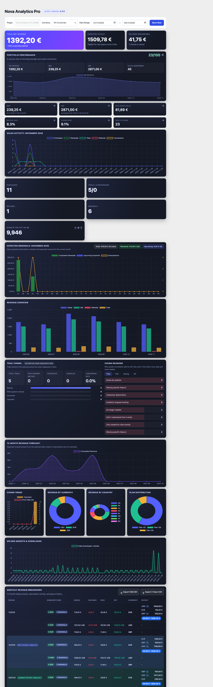

# RL Freemius Business Intelligence

**Version:** 1.4.12  
**Author:** Rosendo Labs  
**License:** GPL-2.0+  
**Text Domain:** rl-freemius-bi

## Overview

RL Freemius Business Intelligence (FSBI) is a comprehensive WordPress plugin that provides an enterprise-grade Business Intelligence dashboard for tracking plugin sales, revenue, subscriptions, renewals, MRR, trial conversions, license usage, and net payouts across all Freemius-hosted plugins.

The plugin integrates directly with the Freemius REST API using HMAC-SHA256 authentication and provides real-time data synchronization, interactive dashboards with currency filtering, KPI tracking, trend analysis, and detailed transaction reports.

## Screenshot



*The per-plugin dashboard with demo data: revenue and payout cards, portfolio performance, MRR/ARR, churn reasons split by customer type, and the trial funnel.*

## Features

- **Multi-Plugin Dashboard:** Aggregate data across all your Freemius plugins or drill down into individual plugins
- **Freemius API Integration:** Native HMAC-SHA256 signed requests to Freemius REST endpoints
- **Real-Time Data Sync:** Scheduled hourly sync via WP-Cron with manual on-demand refresh capability
- **Multi-Currency Support:** Segregate and analyze revenue by USD, EUR, GBP, and other currencies
- **Interactive Filters:** One-click currency and plugin filters with date range selection
- **Dynamic Plugin Header:** Displays the clean title of the plugin currently being viewed along with a badge indicating its latest deployed version (cached from Freemius tags API)
- **KPI Dashboards:** Visual progress bars, trend indicators, and percentage growth metrics
- **Revenue Analytics:** Daily/monthly trend charts, current month expected renewals by day, currency distribution pie charts
- **Transaction Reports:** DataTables-powered sortable payment history with status badges
- **Business Metrics:**
  - Gross Revenue (total transaction amount)
  - Net Revenue (after Freemius commission)
  - Monthly Recurring Revenue (MRR)
  - Active Subscription Count
  - Trial Conversion Tracking
  - Renewal vs. First-Time Purchase Analysis
  - Refund Tracking
- **Database Persistence:** 5 dedicated tables for payments, subscriptions, licenses, plans, and balances
- **Kit Subscriber Limit:** Optional cap on active Kit subscribers (empty or `0` = unlimited) with sync-time enforcement
- **Manual Kit Pruning:** Preview and unsubscribe the oldest subscribers that carry this plugin's tags, one bounded batch at a time
- **Zero Data-Loss Policy:** Tables are never dropped on deactivation—historical data is preserved
- **PHP 8.2+ Ready:** Strict type handling, no dynamic properties, explicit float casting

## Installation

1. Upload the `rl-freemius-bi` folder to `/wp-content/plugins/`
2. Activate the plugin via the Plugins menu in WordPress admin
3. Navigate to **Freemius BI → Settings**
4. Complete the 3-step configuration:
   - **Step 1 (API Configuration):** Enter your Freemius Developer ID, Public API Key, and Secret API Key. Save changes to validate the connection and unlock the remaining tabs.
   - **Step 2 (Plugin Scope):** Select which discovered plugins to track using the intuitive Checkbox List (with Select All / Deselect All).
   - **Step 3 (Multi-Currency & Conversion):** Choose your dashboard display currency (converts all 9 Freemius currencies: USD, EUR, GBP, CAD, AUD, CHF, PLN, ILS, RSD), select your locale format, and pick your conversion tool (**FreeCurrencyAPI** or **Wise**).
5. Click **Sync Now** on the Dashboard toolbar to fetch your latest data or let automatic background sync run.

### Obtaining Freemius API Credentials

1. Visit [developer.freemius.com](https://developer.freemius.com)
2. Log in to your developer account
3. Navigate to **Account** → **REST API**
4. Create or retrieve your public and secret API keys
5. Copy your Developer ID
6. Paste the credentials into the RL FSBI settings page (**Step 1: API Configuration**)

---

### Setting Up Multi-Currency Exchange Rate Providers

RL Freemius BI supports automated multi-currency conversion to consolidate your payments and payouts into your chosen dashboard currency (USD, EUR, GBP, CAD, AUD, CHF, PLN, ILS, RSD). You can configure your preferred provider in **Freemius BI → Settings → Step 3 (Multi-Currency & Conversion)**:

#### Option A: Wise (TransferWise) Integration (Recommended)

Wise provides real-time mid-market exchange rates and historical daily rates aligned with Freemius's monthly payout schedule (the 10th of every month at 14:00 UTC).

1. Log in to your **Wise Account** at [wise.com](https://wise.com).
2. Go to **Settings** (or **Manage**) → **API tokens**.
3. Click **Add new token** (or **Create token**).
4. Enter a name (e.g. `Freemius BI Dashboard`).
5. Set permissions to **Read-only** (only exchange rates access is required; no transfer or account permissions are needed).
6. Copy the generated API token.
7. In your WordPress admin:
   - Navigate to **Freemius BI → Settings → Step 3 (Multi-Currency & Conversion)**.
   - Set **Conversion Provider** to **Wise (TransferWise)**.
   - Paste your token into the **Wise Read-Only API Token** field.
   - Click **Save Changes**.

> **Note on Performance:** Exchange rates from Wise are cached in WordPress transients (`rl_fsbi_wise_*`) for 1 hour to prevent redundant API calls.

#### Option B: FreeCurrencyAPI Integration

FreeCurrencyAPI provides real-time foreign exchange rates for global currency pairs with a free tier of up to 5,000 requests per month.

1. Go to [freecurrencyapi.com](https://freecurrencyapi.com) and sign up for a free account.
2. In your FreeCurrencyAPI dashboard, copy your **API Key**.
3. In your WordPress admin:
   - Navigate to **Freemius BI → Settings → Step 3 (Multi-Currency & Conversion)**.
   - Set **Conversion Provider** to **FreeCurrencyAPI**.
   - Paste your key into the **FreeCurrencyAPI Key** field.
   - Click **Save Changes**.

> **Note on Performance:** Rates from FreeCurrencyAPI are cached in WordPress transients (`rl_fsbi_fx_fca_*`) for 1 hour.

#### Option C: None (Nominal 1:1)
If you prefer not to convert non-base currency payments, select **None**. Non-base currency amounts will be summed at nominal 1:1 values.

---

### How the Health Score (0–100) is Measured

The **Health Score** is an automated composite index measuring overall SaaS stability and momentum across 4 performance pillars:

1. **Refund Control (30 points max):**
   - Full **30 pts** if refund rate is under 5%.
   - Penalized by 2 pts for every 1% in refund rate above 5% (`max(0, 30 - refund_rate * 2)`).
   - Reaches 0 pts if refund rate reaches 15%.
2. **Subscriber Churn (25 points max):**
   - Full **25 pts** if monthly subscriber churn is under 3%.
   - Penalized by 4 pts for every 1% in churn above 3% (`max(0, 25 - churn_rate * 4)`).
   - Reaches 0 pts if churn reaches 6.25%.
3. **Trial Conversion (25 points max):**
   - Full **25 pts** if trial-to-paid conversion rate exceeds 25%.
   - Scaled proportionally if under 25% (e.g. 18% conversion rate awards 18 pts).
4. **Revenue Momentum (20 points max):**
   - **20 pts** if net revenue grew compared to the previous period.
   - **10 pts** baseline if revenue was flat or lower.

Hovering over the info icon next to **Health Score** on the dashboard displays this breakdown directly in an interactive tooltip.

## Database Schema

The plugin creates 8 custom tables (with your site's `wp_` prefix). Schema upgrades run automatically on `plugins_loaded` whenever `RL_FSBI_DB_VERSION` increases, so updates do not require deactivation:

### `wp_rl_fsbi_payments`
Stores all payment transactions from Freemius.

| Column | Type | Purpose |
|--------|------|---------|
| `id` | bigint | Primary key |
| `plugin_id` | bigint | Freemius plugin ID |
| `payment_id` | bigint | Unique payment ID (UNIQUE) |
| `user_id` | bigint | Freemius user/customer ID |
| `subscription_id` | bigint | Subscription ID (nullable) |
| `transaction_date` | datetime | Payment timestamp |
| `gross` | decimal(10,2) | Gross transaction amount |
| `net` | decimal(10,2) | Net (after commission) |
| `fee` | decimal(10,2) | Freemius commission |
| `currency` | varchar(3) | ISO 4217 code (USD, EUR, etc.) |
| `payment_method` | varchar(50) | Payment gateway |
| `status` | varchar(20) | completed, pending, failed, etc. |
| `country_code` | varchar(2) | ISO 3166-1 alpha-2 code |
| `is_refund` | tinyint(1) | Boolean: is this a refund? |
| `refund_id` | bigint | Refund payment ID (if applicable) |
| `payment_type` | varchar(20) | Freemius `type` (purchase, renewal, refund, …) |
| `is_renewal` | tinyint(1) | Authoritative renewal flag reported by Freemius |
| `gateway` | varchar(50) | Payment gateway identifier |
| `gateway_fee` | decimal(10,2) | Gateway processing fee |
| `vat` | decimal(10,2) | Tax portion of the transaction |
| `coupon_id` | bigint | Coupon applied to the transaction |
| `plan_id` | bigint | Plan purchased |
| `pricing_id` | bigint | Pricing row purchased |
| `license_id` | bigint | License created by the payment |
| `install_id` | bigint | Install that generated the payment |
| `bound_payment_id` | bigint | Original payment a refund is bound to |
| `refund_reason` | varchar(100) | Freemius refund reason code |
| `metadata` | longtext | JSON blob for future extension |
| `created_at` | datetime | Record creation timestamp |
| `updated_at` | datetime | Last update timestamp |

**Indexes:** plugin_id, user_id, transaction_date, currency, subscription_id

### `wp_rl_fsbi_subscriptions`
Stores active and historical subscription records.

| Column | Type | Purpose |
|--------|------|---------|
| `id` | bigint | Primary key |
| `plugin_id` | bigint | Freemius plugin ID |
| `subscription_id` | bigint | Unique subscription ID (UNIQUE) |
| `user_id` | bigint | Customer ID |
| `plan_id` | bigint | Selected plan ID |
| `status` | varchar(20) | active, canceled, expired, etc. |
| `billing_cycle` | varchar(50) | monthly, annual, lifetime |
| `trial_ends` | datetime | Trial expiration (nullable) |
| `next_renewal` | datetime | Next billing date |
| `expires_at` | datetime | Subscription end date |
| `outstanding_balance` | decimal(10,2) | Due amount |
| `currency` | varchar(3) | Billing currency |
| `failed_payments` | int(11) | Consecutive failed renewal attempts (dunning risk) |
| `canceled_at` | datetime | Cancellation timestamp |
| `amount_per_cycle` | decimal(10,2) | Recurring amount per billing cycle |
| `renewal_amount` | decimal(10,2) | Amount expected on renewal |
| `initial_amount` | decimal(10,2) | First payment amount |
| `total_gross` | decimal(10,2) | Lifetime gross for the subscription |
| `tax_rate` | decimal(6,3) | Tax rate applied |
| `pricing_id` | bigint | Pricing row in use |
| `license_id` | bigint | License tied to the subscription |
| `install_id` | bigint | Install tied to the subscription |
| `metadata` | longtext | Extra data (JSON) |
| `created_at` | datetime | Creation timestamp |
| `updated_at` | datetime | Update timestamp |

**Indexes:** plugin_id, user_id, status, next_renewal

### `wp_rl_fsbi_licenses`
Stores license activation and usage data.

| Column | Type | Purpose |
|--------|------|---------|
| `id` | bigint | Primary key |
| `plugin_id` | bigint | Freemius plugin ID |
| `license_id` | bigint | Unique license ID (UNIQUE) |
| `user_id` | bigint | License owner |
| `plan_id` | bigint | Associated plan |
| `license_key` | varchar(255) | Activation key (UNIQUE) |
| `status` | varchar(20) | valid, expired, revoked |
| `quota_sites` | int(11) | Max sites allowed |
| `active_sites` | int(11) | Currently active sites |
| `expires_at` | datetime | License expiration |
| `created_at` | datetime | Creation timestamp |
| `updated_at` | datetime | Update timestamp |

**Indexes:** plugin_id, user_id, status, expires_at

### `wp_rl_fsbi_plans`
Stores pricing plan metadata.

| Column | Type | Purpose |
|--------|------|---------|
| `id` | bigint | Primary key |
| `plugin_id` | bigint | Freemius plugin ID |
| `plan_id` | bigint | Unique plan ID (UNIQUE) |
| `plan_name` | varchar(255) | Human-readable name |
| `description` | longtext | Plan details |
| `price_usd` | decimal(10,2) | USD pricing |
| `price_eur` | decimal(10,2) | EUR pricing |
| `price_gbp` | decimal(10,2) | GBP pricing |
| `billing_cycle` | varchar(50) | Billing frequency |
| `trial_days` | int(11) | Trial period length |
| `features` | longtext | Feature list (JSON) |
| `created_at` | datetime | Creation timestamp |
| `updated_at` | datetime | Update timestamp |

**Indexes:** plugin_id

### `wp_rl_fsbi_balances`
Stores developer payout and balance information.

| Column | Type | Purpose |
|--------|------|---------|
| `id` | bigint | Primary key |
| `app_id` | bigint | Freemius app ID (5172 for FSBI) |
| `developer_id` | bigint | Developer account ID |
| `processed_balance` | decimal(10,2) | Confirmed payout amount |
| `pending_balance` | decimal(10,2) | Awaiting payout |
| `commission_rate` | decimal(5,2) | Freemius commission % |
| `commission_amount` | decimal(10,2) | Total commission charged |
| `net_payout` | decimal(10,2) | Your earnings |
| `currency` | varchar(3) | Payout currency |
| `updated_at` | datetime | Last sync timestamp |

**Indexes:** developer_id, app_id

### `wp_rl_fsbi_trials`
Stores trial records from the Freemius trials endpoint.

| Column | Type | Purpose |
|--------|------|---------|
| `id` | bigint | Primary key |
| `plugin_id` | bigint | Freemius plugin ID |
| `trial_id` | bigint | Freemius trial ID (UNIQUE) |
| `user_id` | bigint | Freemius user ID |
| `payment_id` | bigint | Payment linked to the trial, if any |
| `subscription_id` | bigint | Subscription created from the trial |
| `license_id` | bigint | License issued for the trial |
| `started_at` | datetime | Trial start (Freemius `created`) |
| `trial_ends_at` | datetime | Trial expiration |
| `with_payment_method` | tinyint(1) | Customer supplied a payment method |
| `canceled_at` | datetime | Trial canceled |
| `converted_at` | datetime | Trial converted to paid |
| `environment` | varchar(20) | Freemius environment |
| `metadata` | longtext | Raw API payload (JSON) |

**Indexes:** plugin_id, trial_ends_at, started_at, converted_at, user_id

### `wp_rl_fsbi_installs`
Stores site installations reported by Freemius, focused on uninstalled sites used for churn analysis.

| Column | Type | Purpose |
|--------|------|---------|
| `id` | bigint | Primary key |
| `plugin_id` | bigint | Freemius plugin ID |
| `install_id` | bigint | Freemius install ID (UNIQUE) |
| `user_id` | bigint | Freemius user ID |
| `license_id` | bigint | License in use |
| `plan_id` | bigint | Plan in use |
| `site_id` | varchar(64) | Site identifier |
| `title` | varchar(255) | Site title |
| `url` | varchar(255) | Site URL |
| `version` | varchar(50) | Plugin version installed |
| `is_active` | tinyint(1) | Install currently active |
| `is_premium` | tinyint(1) | Premium plan active |
| `is_uninstalled` | tinyint(1) | Site uninstalled the product |
| `last_seen_at` | datetime | Last activity reported |
| `environment` | varchar(20) | Freemius environment |
| `metadata` | longtext | Raw API payload (JSON) |

**Indexes:** plugin_id, is_uninstalled, user_id, plan_id

### `wp_rl_fsbi_uninstalls`
Stores the uninstall feedback Freemius collects (`reason_id` and free-text `reason_info`).

| Column | Type | Purpose |
|--------|------|---------|
| `id` | bigint | Primary key |
| `plugin_id` | bigint | Freemius plugin ID |
| `install_id` | bigint | Install that was removed |
| `uninstall_id` | bigint | Freemius uninstall record ID |
| `site_id` | varchar(64) | Site identifier |
| `reason_id` | bigint | Freemius reason code (`0` = not provided) |
| `reason_label` | varchar(191) | Human-readable reason returned by Freemius (e.g. "No longer needed") |
| `reason_info` | text | Free-text reason supplied by the customer |
| `uninstalled_at` | datetime | Uninstall timestamp |
| `metadata` | longtext | Raw API payload (JSON) |

**Indexes:** plugin_id, reason_id, uninstalled_at, UNIQUE (plugin_id, install_id)

### Metadata backfill

When upgrading from a schema older than `1.2.0`, the plugin copies the fields listed above out of the existing `metadata` JSON blobs into the new columns. The backfill is resumable: it stores a row-ID cursor in `rl_fsbi_backfill_payments_cursor` / `rl_fsbi_backfill_subscriptions_cursor` and continues on the next request if PHP times out.

## Dashboard Pages

### Main Dashboard
**Menu:** Freemius BI → (main)

Displays:
- **KPI Cards:** Gross Revenue, Net Revenue, MRR, Active Subscriptions
- **Filter Controls:** Plugin selector, currency toggle, date range picker
- **Sales Activity Chart:** Current month daily purchases, renewals, trials, refunds, conversions
- **Expected Renewals Chart:** Current month daily expected renewals (completed renewals + upcoming scheduled renewals by day, dual-axis for revenue amounts and subscription counts, with total/completed/upcoming badge counters)
- **Revenue Trend Chart:** Daily/monthly gross revenue line chart
- **Trial Funnel:** Trials started in the selected period, how many supplied a payment method, converted, or canceled, plus a source badge (live trial records vs. estimated from subscriptions)
- **Churn Reasons:** Uninstall feedback grouped by reason for the last 12 months, most frequent first
- **Currency Distribution Chart:** Pie chart showing revenue by currency
- **Recent Payments Table:** DataTables-powered transaction history

### Settings Page
**Menu:** Freemius BI → Settings

Built on the RL Options Framework, featuring:
- **API Configuration:** Freemius Developer ID, Public API Key, Secret API Key with automated connection validation
- **Plugin Scope:** Selective plugin tracking toggles from discovered plugins, a per-product **WordPress.org slug** with its last lookup result, and a per-product **monthly new subscription target** (empty = no target)
- **Multi-Currency & Display:** Consolidated base currency, currency conversion provider, number formatting
- **Synchronization:** Background WP-Cron schedule, frequency, and data retention settings
- **Newsletter:** Multi-provider email marketing integration (Mailchimp and Kit.com / ConvertKit V4 API) with automatic tag discovery, default tag assignment, plan-to-tag mapping, website origin custom field tracking (`WEBSITE` / `website`), and independent diagnostic sample test runners with live `rlLOG` streaming.
- **Support:** System environment diagnostic and support details

## Newsletter & Email Marketing Integration

The plugin supports syncing opted-in users (`is_marketing_allowed === true`) from Freemius into either **Mailchimp** or **Kit.com (Kit API V4)**:

### Provider Selection
- Configure under **Settings > Newsletter**.
- Toggle between **Mailchimp** and **Kit.com**.
- Each provider reveals dedicated API configuration, plan-to-tag mappings, and an interactive **Sample Run** console.

### Kit.com Integration (Kit API V4)
- **Base URL:** `https://api.kit.com/v4/`
- **Authentication:** `X-Kit-Api-Key: <V4_API_KEY>` header. Personal V4 API keys are generated under *Kit Settings > Developer > V4 API Keys*.
- **Tag Discovery:** `GET /v4/tags` dynamically populates default and plan-level tag dropdowns.
- **Audience Total:** `GET /v4/subscribers?include_total_count=true&per_page=1` pulls real-time subscriber totals for the KPI widget.
- **Custom Fields:** Automatically verifies and provisions the `Website` custom field via `GET /v4/custom_fields` and `POST /v4/custom_fields`.
- **Subscriber Upsert & Tagging:**
  1. `POST /v4/subscribers` creates or updates subscriber details with `first_name` and `fields.website`.
  2. `POST /v4/tags/{tag_id}/subscribers/{subscriber_id}` attaches the corresponding Freemius plan tag.

### Mailchimp Integration
- **API Base:** `https://<dc>.api.mailchimp.com/3.0`
- **Authentication:** HTTP Basic Auth with API Key.
- **Audience / Tags:** Discovers audiences and user interest tags, writes the `WEBSITE` merge field.

### Kit Subscriber Limit & Pruning

Kit plans are billed on the number of **active** subscribers. Freemius BI can keep the account under a cap without stopping the sync entirely.

**Setting:** *Freemius BI → Settings → Newsletter → Kit → Subscriber Limit*
- Enter a number (e.g. `10000`) to cap the account at that many active subscribers.
- Leave empty or set `0` for unlimited.

**How the limit is enforced.** Before a sync run, the plugin reads the live active-subscriber total from Kit. When the total is at or above the limit, the run **stops adding new subscribers** and reports how many were skipped:
- Cron delta sync: the skip count is appended to the `rl_fsbi_newsletter_cron_status` option.
- Batched opt-in sync: skipped contacts appear in the sync modal log.
- Sample test run: skipped contacts are logged as warnings.

Existing subscribers are still matched, updated, and tagged — only new additions are blocked. If the count request itself fails, the sync proceeds (the cap cannot be verified) and the limit is not enforced for that run.

**Pruning.** The same section renders a *Kit subscriber quota* panel:

1. **Refresh from Kit** — read-only. Re-reads the active total and the next 25 candidates live from Kit.
2. **Unsubscribe oldest batch** — requires a confirmation dialog, then unsubscribes up to 25 subscribers. Repeat until you are under the limit.
3. **Remove all over the limit** — requires a confirmation dialog, then drains everything above the limit in one run, 25 per request, updating the progress bar from Kit's own count after every chunk. **Stop** halts the run between chunks (the in-flight chunk always completes). Keep the tab open; if you close it the run stops and you can start it again.

> **Unsubscribing is permanent.** Kit treats it the same as the subscriber clicking unsubscribe: the record and tags are kept, but the person stops receiving all email and must explicitly opt in again. The plugin never prunes automatically — it only runs when an administrator clicks a button.

**Scope.** The *Prune Scope* setting decides who is eligible:

- **Any active subscriber** (default) — the oldest active subscribers first, regardless of tags.
- **Only subscribers tagged by this plugin** — restricted to the configured *Default Tag* plus any *plan tag* mappings, so subscribers imported into Kit from elsewhere are never touched. If no tags are configured the tool refuses to run.

**Accuracy.** The panel sends the exact subscriber IDs it previewed and the server unsubscribes each ID exactly once, then reports Kit's own active total instead of `total - removed`. This matters because Kit's `/subscribers?status=active` list lags a few seconds and Kit accepts unsubscribing an already-cancelled contact — re-deriving "the oldest N" on every chunk used to re-process the same people while the UI still counted them as removed.

**Batch size.** 25 per click, sent as five 5-subscriber requests so the progress bar reflects real work. Each action is deliberate; nothing runs automatically.

### Kit.com Manual CSV Export
- **One-Click Instant Download:** Download the latest complete opted-in subscribers CSV file directly via the **📥** button on the dashboard Newsletter KPI widget or the modal footer.
- **Server-Side Generation & Email Delivery:** Generates complete CSV exports in chunked batches directly on the server to prevent browser HTTP timeouts on large subscriber lists (e.g. 17,000+ scanned Freemius users). Upon completion, automatically emails the completed CSV file to the site's admin address (`admin_email`) as an attachment and keeps it cached in `wp-content/uploads/fsbi-exports/` for instant one-click downloads.
- **Export Storage Hardening:** Exports contain customer emails, so the `fsbi-exports/` directory is created with an `.htaccess` deny rule (Apache 2.4 and 2.2 syntax) plus an `index.php` silence file, files are named with a random 32-character token, and exports older than 24 hours are pruned automatically on the next generation. Delivery always goes through the nonce- and capability-protected `admin-ajax.php` handler; files are never linked directly. On Nginx, add an equivalent `location` deny rule for `wp-content/uploads/fsbi-exports/`.
- **Kit.com Import Format:** Generates UTF-8 BOM CSV files fully compliant with [Kit Subscriber Import guidelines](https://help.kit.com/en/articles/2502555-how-to-import-a-subscriber-list) featuring column headers: `Email Address`, `First Name`, `Last Name`, `Tags`, `Website`, `Freemius User ID`, `Plugin`, `Opted In Date`.
- **Automatic Checkpoint:** Generating the export automatically updates the sync timestamp checkpoint (`rl_fsbi_newsletter_last_sync_utc`), enabling subsequent daily syncs to process delta users only.

### Automated Daily Delta Sync
- **WP-Cron Execution:** Integrated directly into `rl_fsbi_scheduled_sync` (`sync_daily_newsletter_optins_delta()`).
- **High Performance Delta Processing:** Leverages Freemius API reverse chronological ordering (newest first). Scanning stops immediately upon reaching contacts at or prior to `rl_fsbi_newsletter_last_sync_utc`, completing daily delta syncs in seconds without scanning the entire backlog.
- **Interactive Delta Sync:** The dashboard sync modal provides a "Sync latest opt-ins only (since last sync)" toggle with live visual checkpoint display.

### Sample Diagnostic Test Run
- Test sync runs with configurable batch sizes (10 to 500) and optional **Dry Run** mode.
- Streams live progress, user evaluation, install site discovery, and API responses directly to the embedded `rlLOG` console.

## Freemius API Integration

### Endpoints Consumed

| Endpoint | Method | Purpose |
|----------|--------|---------|
| `/v1/developers/{id}/plugins.json` | GET | Fetch all plugins |
| `/v1/developers/{id}/plugins/{pid}/stats.json` | GET | Plugin statistics (LTV, customers, revenues) |
| `/v1/developers/{id}/plugins/{pid}/performance.json` | GET | Performance metrics (installs, active, MRR) |
| `/v1/developers/{id}/plugins/{pid}/payments.json` | GET | Payment transactions (paginated) |
| `/v1/developers/{id}/plugins/{pid}/subscriptions.json` | GET | Subscription records (paginated) |
| `/v1/developers/{id}/plugins/{pid}/licenses.json` | GET | License activations (paginated) |
| `/v1/developers/{id}/plugins/{pid}/plans.json` | GET | Pricing plan data |
| `/v1/developers/{id}/plugins/{pid}/trials.json` | GET | Trial records (paginated) |
| `/v1/developers/{id}/plugins/{pid}/installs.json?filter=uninstalled` | GET | Uninstalled site installs (paginated) |
| `/v1/developers/{id}/plugins/{pid}/installs/{iid}/uninstall.json` | GET | Uninstall reason feedback |
| `/v1/developers/{id}/plugins/{pid}/revenues.json` | GET | Time-series revenue data |
| `/v1/developers/{id}/plugins/{pid}/users.json` | GET | Plugin users and marketing consent (paginated) |
| `/v1/developers/{id}/plugins/{pid}/users/{uid}/installs.json` | GET | User install site origins (URL, title, version) |
| `/v1/apps/{app_id}/developers/{id}/balance.json` | GET | Account balance and payout info |

### Authentication Scheme

All requests are signed using **HMAC-SHA256** per Freemius specifications:

```
Authorization: FS {developer_id}:{public_key}:{signature}

Signature = Base64(HMAC-SHA256(
    secret_key,
    StringToSign
))

StringToSign = 
    HTTP_METHOD + "\n" +
    Content-MD5 + "\n" +
    Content-Type + "\n" +
    Date (RFC 2822) + "\n" +
    CanonicalizedResource (path + query)
```

### Pagination

Collection endpoints support:
- `count` (1–50, default 25)
- `offset` (pagination offset)

The plugin automatically loops through all pages until all records are fetched.

### Retry Logic

Failed requests use exponential backoff:
- Attempt 1: immediate
- Attempt 2: 1 second wait
- Attempt 3: 2 seconds wait
- Attempt 4: 4 seconds wait

## Business Logic Definitions

### New Purchase vs. Renewal
A payment is classified as a **Renewal** when Freemius reports `is_renewal = true` on the payment. When that flag is absent, the `is_renewal` column is consulted, and only then does it fall back to the legacy heuristic (a payment with a subscription ID is treated as a renewal). Otherwise it is a **First-Time Purchase**.

### Refunds
Payments where `gross < 0` or linked to a refund transaction ID are flagged as `is_refund = 1`.

### Trial Conversions
Computed from the `rl_fsbi_trials` table: a trial is converted when Freemius reports `converted_at`, and canceled when `canceled_at` is set without a conversion. Before the trials endpoint has been synced, the dashboard falls back to the subscription-derived estimate and labels it as such.

### Churn Reasons
`rl_fsbi_installs` is synced with `filter=uninstalled`, and the uninstall feedback for each of those installs is fetched from the per-install uninstall endpoint. Reasons are grouped by `reason_id`; `0` means Freemius had no reason on record. The dashboard shows the `reason_label` returned by the API (falling back to `reason_info`, then to the numeric ID).

### Multi-Currency Segregation
Per-currency buckets stay separate everywhere (`mrr_native_by_currency`, distribution charts) and are never added together as if they shared a currency. When one consolidated figure is needed — MRR and ARR — each bucket is converted to the reporting currency using the rate stored for that date and only then summed.

### The WordPress Dashboard Widget ("Portfolio Performance")

Registered with `wp_add_dashboard_widget()` on the main WordPress dashboard, so nothing has to be opened to see how the portfolio is doing. It is rendered entirely from the local synced tables — no Freemius request is made on a wp-admin page load — and its payload is cached for 5 minutes under a key that includes the sync generation and the current date.

| Figure | How it is calculated |
| --- | --- |
| Net Revenue | Every payment in the current, previous and month-before window, fees removed, each converted at **that transaction day's** rate to the reporting currency, then summed. |
| MRR / ARR | Active subscriptions' renewal amounts, monthlyised by billing cycle and converted. ARR = MRR × 12. |
| Active Subscribers | Subscriptions counted active as of today by `calculate_subscription_stats()` — the same row set the product dashboard KPI uses. |
| All plugins in scope (N) | Shown under MRR, ARR and Active Subscribers; N is the number of tracked plugins, and hovering lists each product's own subscribers or MRR. |
| New subscriptions: X / TARGET | **First-time paid subscriptions started in the current month**, excluding renewals, refunds and trial starts. TARGET is the sum of the per-product targets set under Plugin Scope and disappears entirely when none is set. |
| · Y reactivations | Customers whose earlier subscription had already ended and who subscribed again. Counted separately and **not** included in X. |
| Current / Next payout | Net revenue of the month belonging to the payout marked CURRENT or NEXT in the table, with its expected date. The public Freemius API documents no payout endpoint and no payout date, so the date is derived from **Settings → Payout day of month** and **Payout lag (months)** and is always labelled `estimated`. |
| N renewals due in the next 30 days · M with failed payment | Active subscriptions renewing inside 30 days, and active subscriptions carrying at least one failed payment — the same definition the reconciled Retention block uses. The line is hidden when both are 0 and links to the Retention block of the dashboard. |
| Current month bar | Labelled `Nov (to 11 Nov)` so a month in progress is not read as a drop, with a dashed **Projection** bar = net so far ÷ days elapsed × days in the month. |

The three-month chart, the months table and the per-plugin breakdown (subscribers, MRR, new this month, reactivations) all sit inside the widget; each product name links to its own dashboard and the footer links to the portfolio dashboard. The metric grid follows the widget's own width through a container query rather than the viewport, because a WordPress dashboard column is not proportional to the window.

## KPI definitions
- **MRR** — every active subscription's renewal amount, monthlyised by billing cycle, converted to the reporting currency and summed.
- **ARR** — MRR × 12.
- **AOV** — net revenue for the period divided by all payments taken in it (new + renewal). Renders as `—` when the period has no payments, never `0.00`.
- **Churn** — cancellations dated inside the selected period divided by the subscriber base that existed at the start of that period.
- **Health score** — weighted sum of refund control (30), churn (25), trial conversion (25) and revenue momentum (20); the exact breakdown is shown in the KPI tooltip.

## WP-Cron Scheduling

By default, the plugin schedules an hourly sync event: `rl_fsbi_scheduled_sync`

To manually trigger a sync:
```bash
wp cron event run rl_fsbi_scheduled_sync
```

Or use the **Sync Now** button in the admin dashboard.

## Admin AJAX Endpoints

### `wp_ajax_rl_fsbi_sync_data`
Manually triggers data synchronization with Freemius API.

**Parameters:**
- `nonce` (required): Security token from `wp_create_nonce( 'rl_fsbi_nonce' )`

**Response:**
```json
{
  "success": true,
  "data": {
    "message": "Data synchronized successfully"
  }
}
```

### `wp_ajax_rl_fsbi_get_dashboard_data`
Fetches dashboard metrics and transaction data for display.

**Parameters:**
- `nonce` (required)
- `plugin_id` (optional): Specific plugin or `all`
- `currency` (optional): Filter by currency or `all`
- `start_date` (optional): YYYY-MM-DD format
- `end_date` (optional): YYYY-MM-DD format

**Response:**
```json
{
  "success": true,
  "data": {
    "gross_revenue": 5000.00,
    "net_revenue": 3500.00,
    "mrr": 1200.50,
    "active_subscriptions": 42,
    "payments": [...],
    "revenue_trend": {"2024-01-01": 500, ...},
    "currency_distribution": {"USD": 4000, "EUR": 1000}
  }
}
```

### `wp_ajax_rl_fsbi_export_monthly_csv`
Streams a CSV file containing 12-month or 3-year (36-month) rolling revenue breakdown data with currency breakdowns and totals.

**Parameters:**
- `nonce` (required)
- `period` (optional): `12m` (default) or `3y` (last 36 months)
- `plugin_id` (optional): Filter by plugin ID or `all`
- `currency` (optional): Filter by currency or `all`
- `end_date` (optional): YYYY-MM-DD format reference date

### `wp_ajax_rl_fsbi_kit_prune_preview`
Read-only preview of Kit quota status. Never changes subscriber state.

**Parameters:**
- `nonce` (required)
- `preview_size` (optional): how many candidates to return, 1–500, defaults to 25. The drain uses 500 to avoid a round trip between every 25 removals.

**Response:**
```json
{
  "success": true,
  "data": {
    "limit": 10000,
    "total": 10997,
    "excess": 997,
    "scope": "all",
    "batch_size": 25,
    "preview_size": 25,
    "candidate_count": 25,
    "tag_count": 2,
    "candidates": [
      { "id": 123, "email": "d****@example.com", "created_at": "2008-04-11T09:12:00Z" }
    ]
  }
}
```
Requires a configured Kit API key and a non-zero subscriber limit.

### `wp_ajax_rl_fsbi_kit_prune_batch`
Unsubscribes one bounded batch of subscribers. **Destructive and irreversible.**

**Parameters:**
- `nonce` (required)
- `confirm` (required): must be exactly `yes`
- `batch_size` (optional): 1–25, defaults to 25
- `subscriber_ids` (optional): JSON array of Kit subscriber IDs to unsubscribe. **Always send this** — it is the list the preview returned. IDs are de-duplicated and capped at `batch_size`. When omitted the handler falls back to re-collecting the oldest eligible subscribers, which can re-process the same contacts while Kit's list catches up.

**Response:**
```json
{
  "success": true,
  "data": {
    "done": false,
    "removed": 25,
    "failed": 0,
    "total": 10972,
    "excess": 972,
    "errors": []
  }
}
```
Removes at most 25 subscribers per request, stops at the excess count, and reports per-subscriber failures without aborting the batch.

### `wp_ajax_rl_fsbi_get_marketing_optins`
Asynchronously paginates through Freemius users (in batches of 100) to count opted-in users (`is_marketing_allowed === true`). Caches the final count in `rl_fsbi_optins_count_{plugin_id}` and updates the dashboard. Can be triggered manually using the refresh button on the Newsletter Opt-ins widget.

**Parameters:**
- `nonce` (required)
- `plugin_id` (optional): Filter by plugin ID or `all`
- `offset` (optional): User pagination offset (default `0`)
- `count` (optional): Accumulated opt-in counter (default `0`)
- `plugin_index` (optional): Index of plugin currently being processed (default `0`)

**Response:**
```json
{
  "success": true,
  "data": {
    "count": 42,
    "offset": 100,
    "plugin_index": 0,
    "done": false
  }
}
```

### `wp_ajax_rl_fsbi_fetch_mailchimp_data`
Fetches available Mailchimp audiences (lists) and static tags/segments using the configured or submitted Mailchimp API key.

**Parameters:**
- `nonce` (required)
- `api_key` (optional): Mailchimp API key to test or inspect
- `list_id` (optional): Mailchimp Audience ID to fetch tags for

**Response:**
```json
{
  "success": true,
  "data": {
    "lists": {
      "abc1234def": "Master Audience"
    },
    "tags": {
      "12345": "Pro Plan",
      "12346": "Agency Plan"
    }
  }
}
```

### `wp_ajax_rl_fsbi_fetch_mailchimp_list_stats`
Queries Mailchimp's `/lists/{list_id}` endpoint to retrieve verified audience member counts (`stats.member_count`, `stats.unsubscribe_count`, `stats.cleaned_count`) and updates local cached counts.

**Parameters:**
- `nonce` (required)
- `list_id` (optional): Mailchimp Audience ID
- `plugin_id` (optional): Filter identifier or `all`

### `wp_ajax_rl_fsbi_sample_mailchimp_test`
Runs a controlled diagnostic synchronization sample test (1–50 users) with Freemius API, database plan matching, and Mailchimp tag assignment. Supports Dry Run mode and outputs detailed debug logs to `RL_Logger` and the frontend console (`rlLOG`).

**Parameters:**
- `nonce` (required)
- `sample_count` (optional): Number of users to inspect (1–50, default 5)
- `plugin_id` (optional): Specific plugin ID or `all`
- `dry_run` (optional): 1 to simulate without modifying Mailchimp, 0 to execute live upsert

### `wp_ajax_rl_fsbi_sync_mailchimp_optins`
Batch-syncs opted-in Freemius users (`is_marketing_allowed === true`) to the designated Mailchimp audience list with an interactive visual progress modal, live metrics, duplicate resolution, and cancellation support.

**Parameters:**
- `nonce` (required)
- `plugin_id` (optional): Target plugin ID or `all`
- `offset` (optional): User pagination offset (default `0`)
- `synced_count` (optional): Accumulated synced subscribers count
- `scanned_count` (optional): Accumulated users evaluated
- `optins_count` (optional): Accumulated opt-ins found
- `errors_count` (optional): Accumulated errors/skips
- `plugin_index` (optional): Current plugin index in scope

## Understanding Freemius Marketing Opt-ins

### What is a Freemius Opt-in?
A **Freemius Opt-in** is a registered user record in your Freemius Developer Dashboard who has explicitly granted permission to receive marketing and communication emails (`is_marketing_allowed === true`).

### Where do they come from?
Freemius opt-in contacts originate from two primary sources:
1. **Free Version Installs via WordPress.org (The Majority):**
   When a site administrator installs your free plugin from WordPress.org and activates it, the Freemius SDK presents a connect screen:
   > *"Never miss an important update — opt in to receive security & feature updates, educational content, and discount offers."*
   If the admin clicks **"Allow & Continue"**, Freemius registers their account with `is_marketing_allowed: true`. Because they are running the free plugin, they do not have a paid subscription or license row in `wp_rl_fsbi_subscriptions` / `wp_rl_fsbi_licenses`. When synced to Mailchimp, they receive the **Default Tag** (default: `Freemius Opt-in`).
2. **Paid Customers & Trial Users:**
   Users who purchase a license or activate a free trial through Freemius Checkout. When synced to Mailchimp, the system checks their `user_id` against your local subscription and license records and assigns their designated **Plan Tag** (e.g. `PRO USER`, `Agency Plan`). If no active paid plan is found, they fall back to the Default Tag.

## Hooks and Filters

### Actions

**`rl_fsbi_scheduled_sync`**
Fired when hourly cron task runs. Use this to trigger custom sync logic.

```php
add_action( 'rl_fsbi_scheduled_sync', function() {
    // Custom sync logic
});
```

### Filters

More to be added in future versions.

## JavaScript API

Dashboard UI exposes `window.FSBI` object:

```javascript
FSBI.syncData()              // Manually trigger Freemius data sync
FSBI.loadData()              // Refresh dashboard data and display cached counts
FSBI.loadMarketingOptins()   // Manually recount newsletter opt-ins from Freemius
FSBI.syncMailchimpOptins()   // Batch sync newsletter opt-ins to Mailchimp
FSBI.getFilters()            // Get current filter values
```

## PHP 8.2+ Compatibility

- All class properties are explicitly declared
- All database values are explicitly cast to `(float)` before arithmetic operations
- No dynamic properties are created
- Strict type hints are used throughout

## Security Considerations

- **API Keys:** Stored in the `rl_fsbi_settings` option in `wp_options`. Protect your database!
- **Masked Secret Fields:** The Freemius Secret Key, Mailchimp API Key, Kit API Key/Secret, Wise Token, and FreeCurrencyAPI Key render as password inputs and are never written into the page markup. Submitting the field blank keeps the stored value, so other settings can be saved without re-entering secrets.
- **Export Isolation:** Generated opt-in CSVs live outside the plugin directory in `wp-content/uploads/fsbi-exports/`, protected by an `.htaccess` deny rule and a random 32-character filename token, with 24-hour retention.
- **Nonces:** All AJAX requests require nonces
- **Capability Checks:** Admin actions require `manage_options` capability
- **Database Queries:** All queries use `$wpdb->prepare()` with placeholders
- **Input Sanitization:** All user input is sanitized with `sanitize_text_field()` or `wp_kses_post()`
- **Output Escaping:** All output is escaped with `esc_html()`, `esc_attr()`, etc.

## Deploying

Assets are served from `assets/lib/`. When deploying with a file-sync tool, check its ignore list: a bare `vendor` pattern matches at **any depth** and will silently skip `assets/lib/` if it is ever renamed back, and it also skips `includes/library/rloptionsFramework/assets/vendor/`. In a WordPress tree a plugin's `vendor/` directory is shipped code, not local build noise.

Verify after an upload:

```bash
for f in chartjs/chart.min.js datatables/jquery.dataTables.min.js datatables/jquery.dataTables.min.css tippy/tippy.umd.min.js tippy/tippy.css popper/popper.min.js; do
  printf "%-38s " "$f"
  curl -sI "https://example.com/wp-content/plugins/rl-freemius-bi/assets/lib/$f" | head -1
done
```

All six should answer `200`. If the plugin screens show the "This upload is incomplete" banner, the sync skipped `assets/lib/` and named which files are missing.

## Read-Only Summary Endpoint

`GET /wp-json/rl-freemius-bi/v1/summary`

A stable, non-personal contract for other systems. The response carries no email addresses, user ids, install secrets or API keys — only aggregates.

| Parameter | Default | Notes |
|---|---|---|
| `plugin_id` | `0` (all tracked plugins) | Scope the figures to one product. |
| `months` | `12` | Trailing months, clamped to `1`–`36`. |
| `currency` | `EUR` | Any 3-letter code; anything else falls back to `EUR`. Conversion keeps the per-day rate rule used by the dashboard. |

Authentication is the normal WordPress one: an administrator session cookie, or an **application password** for a script:

```bash
curl -u "admin:xxxx xxxx xxxx xxxx xxxx xxxx" \
  "https://example.com/wp-json/rl-freemius-bi/v1/summary?plugin_id=9001"
```

Response shape:

```json
{
  "generated_at": "2026-11-11T11:20:00+00:00",
  "plugin_id": 9001,
  "currency": "EUR",
  "period": { "start": "2025-12-01", "end": "2026-11-11", "months": 12 },
  "new_subscriptions": { "months": ["…"], "new": [0], "reactivation": [0], "total": [0] },
  "renewals":    { "months": ["…"], "counts": [0] },
  "cancellations": { "months": ["…"], "counts": [0] },
  "refunds":     { "months": ["…"], "amounts": [0], "counts": [0] },
  "mrr": 0,
  "net_revenue_by_month": { "2026-11": 0 },
  "gross_revenue_by_month": { "2026-11": 0 },
  "coupons": [ { "code": "WINBACK30", "uses": 1, "revenue": 40.17, "discount": "30%", "remaining": 499, "expires": "2026-12-31 23:59:59" } ]
}
```

`new` versus `reactivation` follows the same classification as the dashboard: a reactivation is a first payment from someone whose earlier subscription had already ended. Anonymous requests get `401`, authenticated users without `manage_options` get `403`, and the response is sent with `Cache-Control: private, max-age=300`.

## Performance Tips

1. **Limit Date Ranges:** Use narrow date filters in the dashboard to reduce data load
2. **Batch Processing:** The sync runs in hourly batches; adjust via `wp_schedule_event()` if needed
3. **Database Indexing:** Indexes are automatically created on common query columns
4. **Pagination:** Table view defaults to 25 rows per page

## Troubleshooting

### "Sync failed. Check your API credentials."
- Verify Developer ID, public key, and secret key in Settings
- Ensure your Freemius account has REST API access enabled
- Check that your IP is not blocked by Freemius

### No data appears in dashboard
- Click **Sync Now** button to manually trigger data fetch
- Check browser console for JavaScript errors
- Verify database tables were created: `SELECT * FROM wp_rl_fsbi_payments;`

### "Unauthorized" error
- Ensure you're logged in as an admin
- Check browser console for 403 Forbidden responses
- Verify nonce is being passed in AJAX requests

## Support

For issues and feature requests, please refer to your plugin documentation or contact Rosendo Labs.

## License

GPL-2.0+ - See LICENSE.txt for details

## Updating from GitHub releases

The plugin is not on WordPress.org. Updates are published as GitHub releases on
[drosendo/rl-freemius-bi](https://github.com/drosendo/rl-freemius-bi) and offered
through the normal Plugins screen.

- **Manual only.** The plugin surfaces the standard "update available" row; nothing
  is ever installed without an administrator clicking **Update**. There is no
  auto-update code path.
- The release lookup is cached for **6 hours** (failures for 15 minutes) because
  the unauthenticated GitHub API allows 60 requests/hour **per IP**, which shared
  hosting shares. Use **Plugins → Check again** to force a check.
- The plugin prefers a **release asset** over GitHub's generated tag archive, so
  the archive already contains the correct `rl-freemius-bi/` folder.
  `upgrader_source_selection` renames the folder as a safety net if a generated
  archive is ever used instead.
- The `Update URI` header declares ownership, so a WordPress.org plugin with the
  same slug can never take over update delivery.
- An update **replaces the whole plugin folder**. Never edit files directly on the
  server; the next update will discard them.

### Cutting a release

```bash
# 1. bump BOTH the header and the constant in rl-freemius-bi.php
#    Version:           1.3.11
#    define( 'RL_FSBI_VERSION', '1.3.11' );

git add -A && git commit -m "release 1.3.11: ..." && git push origin master

# 2. build from the commit; --prefix gives the folder the right name
git archive --format=zip --prefix=rl-freemius-bi/ -o /tmp/rl-freemius-bi-1.3.11.zip HEAD

# 3. publish; the asset is what the updater downloads
gh release create v1.3.11 /tmp/rl-freemius-bi-1.3.11.zip --target master --notes "..."
```

**The version bump is what triggers everything.** Tagging a release without
bumping `Version:` means no site will ever see it.

## Changelog

### 1.4.0 (2026-11-11)

**Revenue figures come from one source.**
- The "vs previous period" comparison now derives its figure exactly like the headline it compares against: per-payment net, converted at the transaction day's rate. It previously read the stored `net` column, which is empty for products imported without a settled payout — so a period with 24 payments and €1,177 of gross revenue reported *"no revenue in previous period"*. Revenue momentum in the Health Score uses the corrected comparison too.
- A note appears under the headline total when any payment was converted: *"Converted at each day's rate; small rounding differences may occur."* Per-day conversion is deliberate and unchanged; the note explains why a total can differ by a few cents from a sum taken elsewhere.

**The churn trend and the churn KPI now agree.**
- Both read the same window rule: cancellations inside the window over the base that existed when it opened. The trend previously divided the month's cancellations by that month's *closing* base and only counted subscriptions whose current status was still `cancelled`, so it drew a flat zero while the KPI above it read 1.6%. The current month in the trend now matches the KPI exactly.

**The "WP.org Growth & Downloads" chart was neither.**
- It plotted Freemius payment events per day and was titled as if it were WordPress.org install data. At a handful of sales a day the y-axis appeared frozen between 0 and 3. It is now titled *Freemius Sales Volume (Daily)*, says plainly that it is billing activity and not WordPress.org installs, and draws integer ticks so a low-volume series stops rendering half payments. The payload also exposes the series as `daily_sales_volume`; `wporg_growth` is kept as an alias so existing consumers keep working.

**Debug mode is off unless you ask for it.**
- The framework was configured with `debug_level => 'debug'`, so the Support tab's *Enable Debug Mode* toggle had no effect at all: verbose logging ran on every live site. The level now follows the toggle, which defaults to off, and a warning banner appears on the plugin screens while it is on, linking straight to the setting.

**New KPI: new paid subscriptions against a monthly target.**
- A fourth card in the top row shows the current month's new paid subscriptions against a target you set under *Synchronization* (default 5), with the last six months as a stacked mini bar chart split into **new customers** and **reactivations** — a reactivation being a first payment from someone whose previous subscription had already ended. The card reports the gap to target and how much of it came from returning customers.

**Acquisition, retention and revenue are separated.**
- Three blocks below the headline cards state who arrived (new customers, reactivations, free-to-paid conversion, sales origin), who stayed (active subscriptions, renewals due in 30 days, at-risk renewals, subscriptions with a failed payment, cancellations this month, churn) and what it earned (MRR, ARR, gross, refunds, fees, net). Previously these were spread across a dozen widgets with no thread between them.
- Every first payment is now classified as a **new customer** or a **reactivation** — a first payment from someone whose earlier subscription had already ended.
- Sales origin reads campaign and referral fields from the stored payment payload and says **Unknown** when there are none rather than guessing. Freemius records only a numeric `source` enum, so most installs land in Unknown today.
- **Freemius installs and WordPress.org installs are never combined.** A dedicated *Freemius Installs* widget reports active, premium, uninstalled and total records and states that WordPress.org data is not fetched at all. Fixing this exposed a real bug: `sync_installs()` queried with `filter => 'uninstalled'`, so the local table held *only* sites that had already gone — every install read as uninstalled and the active population was invisible. The crawl is now unfiltered and stores each row as the API reports it.

**Clarity pass.**
- **Plan names, not ids.** The plan distribution and a new toolbar **Plan** filter use the names from the plans table; the filter narrows payments, subscriptions, the previous period and the CSV export together, so nothing drifts out of sync.
- **Coupons widget.** Code, redemptions and net revenue for the selected period, with the discount, remaining uses and expiry pulled from the coupon endpoint (new `retrieve_coupons()` plus `sync_coupons()`, cached in an option rather than a new table). Period-scoped, so a lifetime redemption count can never be mistaken for this month's.
- **Trial Funnel hides itself** when the period contains no trials instead of displaying a row of zeros.
- **Doughnut charts carry their numbers.** The canvas legend is replaced by a real list giving each segment's value and share, so the figures are readable and selectable rather than painted pixels. The forecast chart gained a caption with its total and peak month.
- **Churn reasons say what they are.** The free segment is labelled as reasons given by free-plan users at uninstall, and the label follows the selected chip.
- **"Newsletter Opt-ins" explains its scope**: it counts active subscribers in the provider account, whatever their source, and is explicitly not a count of Freemius customers.
- **"Last synced"** shows when the local copy was refreshed in the site's timezone, next to the existing Sync Now button.

**The dashboard is served from a cached payload.**
- The assembled payload is cached for 15 minutes, keyed by plugin, currency, plan, date range and a generation counter that the sync bumps. On plugin 2228 the response drops from ~200 ms and 29 KB to ~30 ms and 21 KB. Payment rows are excluded from the cached copy because nothing renders them and they are most of the weight.
- The full-screen loading overlay now appears only while the dashboard is still empty. Later refreshes keep the figures on screen and show a small spinner in the toolbar instead.

**Charts are readable without eyes and without a mouse.**
- Every chart canvas gets `role="img"` and an `aria-label` that spells out its points, plus a **View as table** toggle that reveals the same numbers as a real table. Ten charts and nine toggles are live on the plugin dashboard; the toggle keeps `aria-expanded` in step.
- The churn trend draws a **gap** where a month has cancellations but no recorded subscription base — which happens for any month before this site first imported subscriptions — instead of asserting a confident 0%. The card says what a gap means.

**Newsletter consent is explicit and configurable.**
- A new *Marketing Consent Required* setting decides what counts as consent before a contact is pushed to Kit or Mailchimp. Freemius records exactly two relevant fields — `is_marketing_allowed` and `is_verified` — and no consent timestamp, so the tiers are built from those:
  - **Freemius opt-in + verified address** — the default, and the strictest consent the data can actually prove.
  - **Opt-in + verified address + at least one payment** — narrower still, though that is a targeting choice rather than a consent one.
  - **Opt-in only** — the previous behaviour, kept for sites that already rely on it.
  - **Never push automatically** — CSV export only, for sites that hold their own consent records.
- Every sync, export and bulk path now runs through one `user_passes_consent()` check instead of six copies of `! empty($user['is_marketing_allowed'])`, so a new path cannot quietly bypass the rule.
- **Nothing deletes subscribers automatically**, and that is now enforced rather than merely true. Removing Kit contacts needs an explicit *Allow Removing Kit Subscribers* setting (off by default), then a confirmation dialog, and the server rejects both prune endpoints when the setting is off. The prune scope default changed from *any active subscriber* to *only subscribers tagged by this plugin*, because the old default could unsubscribe the whole list.

**Read-only summary endpoint.**
- `GET /wp-json/rl-freemius-bi/v1/summary` returns new subscriptions per month split into new customers and reactivations, renewals, cancellations, refunds, MRR, coupon usage and net revenue per month in EUR — with no email addresses, user ids or keys. It accepts an application password as well as an admin session, clamps `months` to 1–36, falls back to EUR for an unrecognised currency, and refuses anonymous callers with `401`.

**The doughnut charts were ellipses.**
- The three doughnut canvases were pinned to `300x260` (currency, plan) and `500x230` (country), so Chart.js filled a rectangle and drew ovals. They now carry `aspect-ratio: 1 / 1` and keep a circle at any card width — measured `260x260` at 1600px and `115x115` at 820px, ratio 1.00 in both.

**Tooltip assets are bundled and owned by this plugin.**
- `tippy.umd.min.js`, `popper.min.js` and `tippy.css` now live in `assets/vendor/` and are enqueued from there with `filemtime` versions. The dashboard previously borrowed the shared framework folder, and the settings page used the generic handles `tippy-css` / `popper-js` / `tippy-js` — which another active RL plugin claimed first, serving *its* directory. On a site without that plugin the request has nothing to serve, which is exactly the 404-with-HTML-body symptom. The plugin now reclaims those handles last on its own screens, so both pages request one copy each: `assets/vendor/tippy/tippy.css`, `assets/vendor/popper/popper.min.js`, `assets/vendor/tippy/tippy.umd.min.js`, all `200`, no console errors.

**The coupons widget told the truth about nothing.**
- Coupon 114792 rendered as *"Coupon #114792"*, inactive, no discount, unlimited uses, no expiry — while Freemius held `WINBACK30`, 30% off, 500 uses, valid to 31 December 2026. The definitions were only ever fetched during a full sync, so a site that upgraded kept rendering placeholders until the next crawl. They are now fetched on demand when the local copy is empty, with an hourly lock so a broken key cannot turn every page load into an outbound request.
- The table shows **code, discount, status, uses / limit, remaining, expiry, revenue and discount given**. Status distinguishes `active`, `expired`, `exhausted` and `inactive` — `jekra` at 1 of 1 uses now reads Exhausted rather than Active. Discount given is derived from the amount actually charged (`gross × rate / (100 − rate)` for percentage coupons, value × uses for fixed ones) because Freemius stores no pre-discount price on the payment.

**WordPress.org installs are fetched properly, and kept apart.**
- The dashboard used to state that WordPress.org data was not fetched. It now is: active installs come from the plugins API `1.2`, the lifetime download total from `1.0` (each endpoint carries only one of the two), and the 90-day download history from the stats endpoint — cached for a day. Set the slug under **Synchronization → WordPress.org Plugin Slug**.
- The figures live in their own **WordPress.org (free)** widget, which names its source and says outright that these are directory installs of the free plugin, a different population from the Freemius records in the neighbouring widget. The two are never added or compared.

**Every chart is now named, not just most of them.**
- Sales Activity, Freemius Sales Volume, expected renewals and the new-subscription mini chart gained `role="img"`, a spoken title describing what is plotted, and the **View as table** toggle. The titles replace the code-path names the first pass produced, so a screen reader announces *"Sales activity: purchases, renewals, trials and refunds per day"* rather than *"sales chart"*. All 12 canvases are labelled, 12 tables available.

**The endpoint documents itself.**
- **Settings → Support** now documents `GET /wp-json/rl-freemius-bi/v1/summary`: the resolved URL, application-password authentication with a ready `curl`, every query parameter and every response field. The coupon objects in the response carry discount, status, limit and discount given too.

**Follow-up fixes on the 1.4.0 dashboard.**
- **Tooltip assets no longer depend on a complete upload.** They are committed and inside the release archive (verified: `git archive` contains all three under `assets/vendor/`), so a 404 means the deployed copy predates them. Loading now falls back to the copy that has shipped inside the settings framework since the first release, so a partial upload degrades to an older file instead of two 404s. Simulated by removing `assets/vendor/`: all three assets then load `200` from the framework path with `text/css` and `application/x-javascript`, and tooltips work.
- **WordPress.org slugs are per plugin.** The single global field became a per-product editor on the **Plugin Scope** tab, prefilled with each Freemius slug and validated against the wp.org API on save — an unknown slug is rejected rather than stored, since it would render a widget full of zeros. With no slug the widget is not rendered at all (no card, no canvas, no note) and no wp.org request is made.
- **Counts now reconcile with the active total.** "Failed payments" read the raw status, so it reported **337** against a KPI of **190** — it restricted to a different population than the KPI (which also requires a known billing cycle and excludes expired rows). Both it and the plan distribution now use the exact row set the KPI counts: **1** of 190 and **104 + 86 = 190**, against **0** of 45 and **29 + 16 = 45** on the demo product. The label became "Active subs with a failed payment" and the tooltip says it counts subscriptions, not attempts.
- **`rl-fsbi-wporg-chart` is gone.** The Freemius sales-volume canvas is `rl-fsbi-sales-volume-chart` and reads the payload's `daily_sales_volume` key; `wporg_growth` stays as a payload alias for older consumers.

### Unreleased - first-run auto-detection

**When Freemius reports no rate, account age is the evidence.** A first payment before the current pricing started (2026-10-05) means the account was onboarded under the legacy tiers, so the model is preselected as **Legacy progressive (assumed from account age)** with marginal 7.00% and lifetime average 7.95% for product 2228 - labelled as *assumed, not reported by Freemius*, with the hint to confirm in Freemius -> Earnings -> Payouts Information -> Fees Breakdown. It is applied only when the administrator presses Accept, and the Commission tooltip carries the same marker. For 2228 the first payment is 2019-01-15 with the $1,000 and $5,000 boundaries crossed on 2019-02-08 and 2019-10-06.

**Tiers are applied per payment, by position.** Detection records the date each tier boundary is crossed in the lifetime cumulative gross; the widget then charges each payment at the rate of the tier it falls into (27% up to the first $1,000, 17% up to $5,000, 7% after) instead of applying a lifetime average to everything. Refunds reverse the percentage part at the same tier as the sale they reverse.

Verified with the legacy model accepted, product 2228 only: Sep 1,091.19 gross / 150.64 refunds / 57.62 gateway / 78.68 commission / 804.25 net; Oct 799.45 / 0 / 34.27 / 66.31 / 698.87; Nov 282.10 / 0 / 12.36 / 22.60 / 247.14. Every row satisfies `gross - refunds - commission - gateway = net`.


`RL_FSBI_Detection` (`includes/class-rl-fsbi-detection.php`) works the account out from its own data instead of asking for it:

- **Full history**: every payment of every product in scope, paged at 100 until the API returns nothing.
- **Lifetime gross in USD**: only rows with `type = payment` and a positive gross, each converted at its own date through the same converter the dashboards use, so detection and reporting cannot disagree about what a dollar is.
- **Models compared**: legacy progressive (27% to $1,000, 17% to $5,000, 7% after, computed as a lifetime average), current (3.8% + 2.3% + fixed fee) and flat. Legacy wins outright when it lands within one percentage point of the rate in `balances.commission_rate`; otherwise the closest of current and flat wins, and the confidence is `100 - difference/observed*100`.
- **Rate inference is scoped to the products being detected**: `balances` rows are filtered by `app_id IN (scope)`, so a demo or local product can never set the rate for a real one.
- **Also detected**: currencies seen, plans and billing cycles from the synced subscriptions, active installs from the catalog, and a WordPress.org probe of each product's Freemius slug. A slug is prefilled only when the field is empty, so a manual value always wins.
- **One-time summary**: `Setup detected` with every value, the model comparison and the warnings, plus **Accept detected values** (writes the rate only into empty settings), **Edit manually** and **Re-detect** - all plain links, because the settings form must stay the only form on the page.
- **Unknown commission is not zero**: when no rate can be determined, `net = gross - refunds - gateway fees` and the widget carries the warning, rather than netting every month to zero.

Measured on product 2228 alone: lifetime gross **$62,969.95** over **1,375** payments, currencies EUR/USD/GBP, plans 3874 and 4862, cycles 12 and 1, active installs **2,309**, `smart-variations-images` found on WordPress.org at 5.2.39. Legacy would average 7.95%, current 6.10%, and Freemius reports no rate for this product, so the model is reported as unknown with a warning instead of guessing.

### 1.4.12 (2026-11-11)

**Settings could not be saved at all: an empty `number` field aborts the whole form.**

`RL_Field_Number::validate()` rejects anything that is not numeric:

```php
if (!is_numeric($value)) {
    $error = sprintf(__('%s must be a valid number.', ...), $field_label);
    return false;
}
```

An **empty string is not numeric**, and the framework stops the save on the first validation error and redirects — nothing is written. Every optional numeric field I added (revenue share, fixed fee, payout day, payout lag, per-plugin monthly target, monthly subscription target) defaults to empty, so opening Settings and pressing Save failed silently for the whole form, including the WordPress.org slugs.

All optional numeric fields are now `type => 'text'`, which accepts empty, with the value cast and range-clamped on read. Payout day/lag fall back to 15 and 2 when blank; the revenue share falls back to the synced balance only when that reports a rate.

**The WordPress.org slug and the monthly target are now real framework fields.** `rl_fsbi_wporg_slug_{plugin_id}` and `rl_fsbi_monthly_target_{plugin_id}` are registered per tracked product under Plugin Scope, so they are persisted by the framework's own save path. The bespoke `admin-post` forms, their handlers and their hooks are gone; `get_wporg_slug()` and the new `get_monthly_target()` read the fields, falling back to the old maps for values saved before this release.

**Not yet confirmed:** in this environment a save through the browser still did not write `rl_fsbi_wporg_slug_2228` to `rl_fsbi_settings`, and the cause is not identified. The validation fix above is proven from the framework's own validator; the persistence of these two fields needs one save on a real installation to confirm.

### 1.4.11 (2026-11-11)

**Column mapping, gross/refund split and the install count — corrected against the Freemius API.**

- **Commission and Gateway were swapped.** The header row read `Gateway, Commission, VAT` while the cells emitted `Commission, VAT, Gateway`, so the Commission column displayed `gateway_fee` and Gateway displayed 0.00. Cells are now emitted in header order.
- **Gross is sales only.** A row is a sale only when `type` is `payment`; anything else (`refund`, `chargeback`, `lost_dispute`) is excluded from Gross. A `lost_dispute` row carries a **positive** gross and no refund id, so the old sign-based test (`gross < 0 || net < 0 || refund_id || status refunded`) treated it as a sale and added 49.00 to Gross *and* to Refunds.
- **A dispute is not a second refund.** A non-sale row with a positive gross is the original payment recorded as disputed; its matching chargeback carries the negative. Such rows are now skipped, which removes the duplicate: September refunds fall from 199.64 to **150.64** at a 1:1 conversion (59.99 EUR + 41.65 USD + 49.00 USD), against the API's 138.81 EUR — the difference is exchange rate, see below.
- **The dispute fee counts in Gateway.** A chargeback's own 15.00 USD fee is a cost of the month, so it is added to Gateway rather than to the refunded amount.
- **`active_installs_count` from the product.** The Installs card counted rows in the installs table: 9,417 records of which 9,411 are historical uninstalls gave "Active 0 / Uninstalled 9,378". Freemius reports the live figure on the product object (2,309 for product 2228); the plugin catalog now stores it during the plugin sync and the card prefers it, falling back to the table count when it is absent. It stays entirely separate from WordPress.org numbers.

**Why local totals cannot match the API.** This environment has **no `wp_rl_fsbi_exchange_rates` table at all**, so `convert_currency_amount()` returns every amount unchanged. October is the clearest case: EUR 333.21 + USD 466.24 gives 799.45 here and 749.07 in production, i.e. the API's USD→EUR rate of about 0.892 is simply not applied locally. Every column is inflated by the same factor, which is why the *structure* is verifiable here but the absolute EUR totals are only meaningful in production.

### 1.4.10 (2026-11-11)

**A payments re-sync proved that Freemius does not return a commission for this product at all.**

Backed up the payments table to `wp_rl_fsbi_payments_backup_20261111` (2,978 rows), re-fetched every payment for product 2228 through the API, and compared row by row:

| | rows | recorded commission | derived (*) |
| --- | --- | --- | --- |
| Before | 2,978 | 247 | 2,613 |
| After | 2,978 | 247 | 2,613 |

**Zero rows changed.** The API returned 1,375 payments for product 2228 and `fee` was present on **none** of them; the 247 rows that carry a recorded commission all belong to the local demo product, which the API does not know about. So the `*` marker on the real product is not a sync gap that a re-sync can close — the field is simply absent from the response. The commission tooltip now says exactly that instead of implying a retry would fix it:

- all rows recorded → *"14.80% of gross, recorded by Freemius on every payment of the month"*;
- all rows derived → *"Derived: Freemius returned no commission on this month's payments… Re-syncing the payments does not change this"*;
- mixed → the split with counts.

**Refunds carry no commission either.** A raw refund payment straight from the API:

```
gross = -59.99   vat = -12.60   gateway_fee = 0   type = 'refund'
```

There is no `fee` and no `net`, so there is **no commission to reverse** on a refund, and the Commission column must not be reduced by one. The rule the widget applies is therefore: *Refunds = the amount returned to the customer, net of any commission Freemius actually recorded on that row*, which for API refunds is the full amount. That is now stated in the footnote under the table.

**VAT is present and still unaccounted for.** 677 payment rows carry a `vat` value (freely negative on refunds, e.g. −12.60). Whether `gross` is VAT-inclusive decides whether VAT belongs in the identity; it is not being guessed at here — it needs one confirmation against a Freemius payout statement before it becomes a column.

*(The Phase 1 dashboard shell is not in this release: `.rl-fsbi-content-grid` is a single flat grid holding every detailed card, so it has to be decomposed into per-tab groups before tabs can hide anything meaningful. Doing it the quick way would produce tabs that hide nothing.)*

### 1.4.9 (2026-11-11)

**The commission column is recorded data, not a balancing item.**

1.4.8 derived the commission as whatever made the row add up, which would silently absorb any future sync bug. Reverse-engineering the stored columns settled what they actually mean:

- **`payments.fee` is the Freemius commission**: `fee/gross = 14.798%` on every one of the 45 EUR rows that has one (min 14.7978, max 14.8000), matching `balances.commission_rate = 14.80` synced from Freemius.
- **`payments.net = gross - fee` exactly** on those rows (verified 100.0000% across 45 rows).
- **Two row families exist**: rows with `fee > 0, net > 0, gateway_fee = 0` (commission recorded) and rows with `fee = 0, net = 0, gateway_fee > 0` (commission **not** recorded — only the gateway fee was returned by the sync).

So the widget now reads the commission from the payment when it is there, and only applies the synced account rate to rows where it is missing, marking those with `*` and a tooltip naming the rate and the row count. `Gross - refunds - commission - gateway fees = net` holds **by construction**, with no figure left to absorb errors. The **gateway fee** moved to its own column, taken from `gateway_fee`, instead of being folded into the commission.

| Month | Gross | Refunds | Gateway | Commission | Net |
| --- | --- | --- | --- | --- | --- |
| Sep | 3,260.19 | 150.64 | 45.17 | 482.47* | 2,581.91 |
| Oct | 2,571.45 | 0.00 | 34.27 | 380.54* | 2,156.64 |
| Nov (to 11 Nov) | 1,867.10 | 41.75 | 12.36 | 276.30* | 1,536.69 |

Commission is 14.80% of gross in all three months. Net moves down from 1.4.8 (Sep 2,666.39 → 2,581.91, Oct 2,219.00 → 2,156.64, Nov 1,558.69 → 1,536.69) because rows synced without a commission were previously counted as if Freemius took nothing.

**Sanity check.** When Debug Mode is on, a month whose commission deviates more than 20% from the rate Freemius reports is written to the log with the derived-row count, so a future sync regression shows up as a log line rather than as silently absorbed money.

**Why November looked like 0.28%.** It never was: 0.28% was the *residue* left by the 1.4.8 balancing formula, dominated by refund sign handling, not a commission rate. With the recorded rate, November's commission is 14.80% like every other month.

**Why September's gross changed from 3,109.55 to 3,260.19.** September contains refund rows stored with a **negative** `gross` (-59.99, -41.65, -49.00) which were inside the sales total. Once refunds are excluded from *sales* gross and shown in the Refunds column instead, the sales figure rises by the 150.64 that had been netted into it. November moves the other way (-49.00) because its refund row was stored with a *positive* gross that had been inflating sales.

### 1.4.8 (2026-11-11)

**The widget's monthly columns now add up, and the reason they did not is the Freemius commission.**

`Gross - Fees - Net` left a gap of **+55.96 in October**, and the synced refund rows made it worse in the other months (+22.00 November, +85.83 September). The gap is the **Freemius commission**, which the table never showed, and refunds are stored in two incompatible shapes:

| Shape | Example | `gross` | `net` | `fee` |
| --- | --- | --- | --- | --- |
| `payment_type = refund` / `chargeback` | 2026-09 | **negative** | 0 | 0 |
| `is_refund = 1`, no `payment_type` | 2026-11 | **positive 49.00** | positive 41.75 | 7.25 |

Because `Net` was simply `SUM(net)`, the second shape **added revenue** instead of removing it, while `Refunds` (built from `SUM(|net|)`) counted nothing for the first shape. A single `summarise_month_payments()` now normalises refunds to always reduce the month, derives the commission as the balancing figure, and the table gained a **Commission** column:

| Month | Gross | Refunds | Fees | Commission | Net |
| --- | --- | --- | --- | --- | --- |
| Sep | 3,260.19 | 150.64 | 373.89 | 69.27 | **2,666.39** |
| Oct | 2,571.45 | 0.00 | 296.49 | 55.96 | **2,219.00** |
| Nov (to 11 Nov) | 1,867.10 | 49.00 | 254.16 | 5.25 | **1,558.69** |

Every row now satisfies `Gross - Refunds - Fees - Commission = Net`. September and October totals are unchanged; November drops by 83.50 because two refund rows had been adding revenue. The Net Revenue KPI is the sum of the same three rows and now applies the per-payment conversion it previously skipped, so the headline and the table can no longer disagree.

**Other fixes in the widget**
- **The projection is part of the current month's bar**, not a bar of its own: the solid portion is actual data, the dashed portion above it is the linear projection, labelled `Linear projection` and drawn only after 7 days of data.
- **Months run oldest to newest** (Sep, Oct, Nov) instead of newest first.
- **Targets are per plugin**: each row shows `1 / 5` with an icon and text — `on track (1 of 1.8 expected)` or `behind (1 of 2.2 expected)` — comparing progress against the pace needed by today, not a raw percentage. The headline keeps the aggregate and its tooltip names each product's own target and pace.
- **The months table prints bare numbers with the currency named once** ("Net revenue by month, amounts in EUR"), so six columns fit a dashboard column without wrapping.

**WordPress.org: a `Check now` link per product.** The Plugin Scope rows already show the last cached lookup; a cached failure could not tell anyone whether the fetch works today. `Check now` runs one request, prints the outcome — *"WordPress.org answered for smart-variations-images: 1,000 active installs, version 5.2.39."* — refreshes the cached snapshot, rebuilds the dashboard payload and reports the HTTP failure verbatim when it fails. Verified end to end: notice, row timestamp and the dashboard card (1,000 installs, 5.2.39, 90 points).

### 1.4.7 (2026-11-11)

**The "Portfolio Performance" widget on the WordPress dashboard now answers more than three months of revenue.**

- **New subscriptions this month.** A line reading `New subscriptions: 12 / 8 · 1 reactivation · November 2026`: first-time paid subscriptions only (renewals, refunds and trial starts excluded), against the sum of the per-product targets, with reactivations counted separately and *not* added to the total. The target is a new field per product under **Plugin Scope**; leave every one empty and the `/ TARGET` part disappears. Hovering the line, and the expandable **Per-plugin breakdown**, give the same figures per product.
- **The current month is marked as partial.** The bar and the row read `Nov (to 11 Nov)` instead of `Nov`, and a dashed **Projection** bar shows net so far ÷ days elapsed × days in the month. A month in progress is no longer read as a collapse against finished months.
- **Payout dates.** `Current payout: 2,666.39 EUR · 15 Nov 2026` and `Next payout: 2,219.00 EUR · 15 Dec 2026`. The public Freemius API has **no payout endpoint and no payout date** (checked against `api.freemius.com/v1/openapi.json`: 112 paths, none for payouts or balances), so the date comes from two new settings — **Payout day of month** (15) and **Payout lag in months** (2) — and every date carries an `estimated` badge plus a tooltip saying exactly that. No date is invented.
- **Retention alert.** `22 renewals due in the next 30 days · 1 with failed payment`, linking to the Retention block of the dashboard (the block gained the `rl-fsbi-block-retention` anchor). Failed payment uses the same definition as the reconciled counts: active subscriptions carrying a failed payment, restricted to the rows the Active Subscriptions KPI counts. Hidden when both numbers are 0.
- **Scope labels and links.** MRR, ARR and Active Subscribers each carry `All plugins in scope (N)` with a per-product tooltip; each plugin name in the breakdown links to `admin.php?page=rl-freemius-bi-plugin-{id}#dashboard`, and the footer has **Open full dashboard**.
- **No new API traffic.** The widget is built from the synced tables and cached for 5 minutes under a key containing the sync generation and the current date, so a wp-admin page load never reaches Freemius.

**Fixed: the product dashboard collapsed below 1220px.** The WordPress.org and Freemius Installs cards carry `grid-column: span 3`. On the single-column layout that breakpoint switches to, a `span 3` child still forces three implicit tracks, so every card was squeezed into the leftover ~110px. Measured before: `109.484px 450.266px 357.25px` at a 1200px viewport. All direct children now reset to `1 / -1` there: 765px and 941px wide cards at 1024px and 1200px, three columns unchanged at 1440px.

**Fixed: Debug Mode could stay on forever after an upgrade.** The setting used to be written on by default. A one-shot migration now clears it once per release; an administrator who turns it back on keeps it on until the next release. Verified: `enable_debug = true` → off after the first `admin_init`, and re-enabling afterwards survives.

**The WordPress.org widget stops being silent about its own state.** Each row on **Plugin Scope** now reports the stored slug *and the last lookup result* — `Saved: smart-variations-images — last check found 1,000 active installs (2026-11-11 13:47:42)`, or the HTTP failure that stopped it — read from the cached snapshot, so no request is made to render the page. With the widget itself reporting unreachable/not-found inline and logging every probe under Debug Mode, a slug that does not render can be diagnosed from the settings screen alone.

### 1.4.6 (2026-11-11)

**A slug could be saved and then silently thrown away.**
- Saving a slug asked `api.wordpress.org` whether the plugin exists and dropped the slug on *any* failure — a timeout, a DNS error, a 403 from an outbound firewall, or a genuine "no such plugin". On a host where that request does not reach the API, the value was therefore discarded, the field went back to showing the grey placeholder, and the widget could never appear. The check now returns three outcomes instead of a boolean: **found** (stored, and the notice reports the install count), **not_found** (rejected, as before) and **unverifiable** (stored, with the reason shown). Only a definite answer from WordPress.org discards what was typed.
- Saving merges into the stored map instead of replacing it, so a rejected or unverifiable entry can no longer delete the other products' slugs. Emptying one field still clears just that product.
- The field said nothing about its own state — an empty input showed the Freemius slug as a placeholder, which reads exactly like a saved value. Each row now prints **Saved: &lt;slug&gt;** or **Nothing saved**, and the placeholder is a neutral example. The save notice says what happened per slug, and turns green only when every slug was confirmed.

**An empty widget now explains itself.**
- `get_wporg_snapshot()` still cached failures for a full day, so one blip at `api.wordpress.org` left the card blank until the transient expired, with no way to retry but re-saving the slug. Failures are cached for 5 minutes; successes stay cached for a day.
- The card renders whenever a slug is set — including when the fetch fails — and shows why: *"Could not read WordPress.org right now (HTTP 500). It is retried automatically on the next load."*, or that the slug does not exist on WordPress.org. Previously it just sat at "—".
- With **Debug Mode** on, both the save-time probe and the snapshot request are logged with their outcome, e.g. `[rl-fsbi] wp.org info request -> HTTP 200 (https://api.wordpress.org/...)`.

**Verified** by making `api.wordpress.org` unreachable with a temporary `pre_http_request` filter: the slug was stored, the notice read *"Saved, but WordPress.org could not be reached to confirm it: smart-variations-images (cURL error 28: Connection timed out)"*, and the dashboard rendered the card with the amber explanation. Removing the filter and clearing the transient restored **1,000 active installs / 282,127 downloads / 5.2.39** and a 90-point chart. A bogus slug for another product was rejected while the first product's slug survived: *"Saved and confirmed on WordPress.org: smart-variations-images 1,000. Not saved, no such plugin on WordPress.org: this-plugin-does-not-exist-xyz."*

### 1.4.5 (2026-11-11)

**A saved WordPress.org slug now shows up immediately.**
- The dashboard payload is cached for 15 minutes, so saving a slug and reloading kept returning the payload built when there was none: the widget stayed absent and the Freemius Installs card still carried the old *"WordPress.org install data is not fetched by this plugin"* line. Saving the **Plugin Scope** form now bumps the payload cache generation (and clears that slug's snapshot transient), so the next page load rebuilds from the new setting.
- The stale note was removed outright. It described a limitation that no longer exists — the plugin does fetch wp.org installs, for every product that has a slug.

**The date range no longer renders as a bare dash.**
- The two `<input type="date">` fields were emitted empty and filled only by JavaScript, so any load where the bundle did not run showed *"Date Range: —"*. They now render the current month server-side, in the site timezone, and are labelled for screen readers.
- The resolved period is part of the analytics payload (`period.start` / `period.end`), and the dashboard adopts it if the inputs are still blank, so the toolbar always shows the range the numbers were computed for.

### 1.4.4 (2026-11-11)

- Corrected the watchdog message, which still pointed at `assets/vendor/` after the move to `assets/lib/`.
- The deployment config that caused this is documented under *Deploying* below: an SFTP ignore rule matching the bare word `vendor` silently excluded `assets/vendor/` on every upload, which is why the files were in the repository and the release zip but never on the server.

### 1.4.3 (2026-11-11)

**The dashboard could not load at all on production, and two causes were stacked.**

- **Chart.js and DataTables were loaded from `cdn.jsdelivr.net` in the `<head>`.** That is render-blocking, and it was three levels deep in the dependency chain: the dashboard bundle depends on them, so a CDN that stalls or is unreachable meant the bundle never executed and the page sat at *"Loading analytics… 0%"* with nothing in the console to explain it. Both are now bundled under `assets/lib/` (Chart.js 3.9.1, DataTables 1.13.4 with its stylesheet) and the dashboard bundle moved to the footer, so no third-party host can block first paint. The dashboard now makes **zero external requests** — verified: the only off-site request left is WordPress's own Gravatar avatar.
- **The bundle directory was named `vendor`, which deployment tooling ignores.** A sync config that excludes `vendor` (a common default, since it usually holds Composer packages) silently skipped `assets/vendor/` on every upload — which is exactly why those three files 404'd while being present in both the repository and the release zip. Everything now lives in `assets/lib/`, a name no deploy tool filters.

### 1.4.2 (2026-11-11)

**A frozen "Loading analytics… 0%" now explains itself.** A dashboard that hangs told nobody whether the script had failed to load or the request had stalled, which made a partial upload look identical to a slow server. Two changes:
- An inline watchdog in the dashboard markup runs independently of the bundled script. If the page is still loading after 25 seconds it replaces the spinner with the actual reason — *"The dashboard script did not start"* one way, *"The dashboard did not finish loading"* the other — plus a Reload button.
- The analytics request now aborts after 45 seconds with a readable message instead of spinning indefinitely.

**Coupon definitions are fetched in the background.** The previous release fetched them inline when the cache was empty, so the first dashboard load of every hour waited on a Freemius round-trip per plugin. That is now a scheduled event: the request path drops from 1.7 s to 0.002 s on a cold cache, the table shows "definition unavailable" for the intervening seconds, and the fetch bumps the payload cache generation when it lands.

### 1.4.1 (2026-11-11)

**Why this release exists.** `1.4.0` was set as the version on the first commit of the batch, seventeen commits before the build that was actually published. Whatever 1.4.0 was uploaded to a site therefore carries the same number as the published release but none of its contents — no `assets/vendor/`, no coupon fix, no reconciled counts — and the updater compares with a strict `>`, so it never offers the replacement. Reusing a version number has now caused this twice; the number only moves forward from here.

- **The WordPress.org slug is now per product.** The single global field became an editor on the **Plugin Scope** tab with one row per tracked plugin, prefilled from the Freemius slug and validated against the wp.org API on save. An unknown slug is rejected instead of stored, because it would render a widget of zeros. With no slug the widget is not rendered and no wp.org request is made.
- **Counts reconcile with Active Subscriptions.** "Failed payments" filtered on status alone and reported 337 against a KPI of 190, because the KPI also requires a known billing cycle and excludes expired rows. Both it and the plan distribution now use the KPI's own row set: 1 of 190, and 104 + 86 = 190 on the real product; 0 of 45 and 29 + 16 = 45 on the demo one. The label reads "Active subs with a failed payment" and the tooltip says it counts subscriptions, not attempts.
- **Missing vendor files no longer break tooltips.** Loading prefers `assets/vendor/` and falls back to the copy inside the settings framework, so a partial upload degrades to an older file rather than two 404s. An admin banner now names the files that are missing from the deployed copy, so an incomplete upload is visible instead of only showing up in the browser console.
- **`rl-fsbi-wporg-chart` renamed** to `rl-fsbi-sales-volume-chart`, reading the `daily_sales_volume` payload key. `wporg_growth` remains as an alias.

### 1.3.30 (2026-11-10)
- **An autofilled email can no longer become a bogus Developer ID.** A vendor reported that the backfill failed after signing up, and that the browser had filled the Developer ID field with their email address. The field was a plain text input with no autocomplete hints, and the sanitizer kept only the digits — so `john1985@gmail.com` was saved as `1985`, a perfectly valid id belonging to someone else. Every request then authenticated as the wrong account, and the failure described the API rather than the field. The sanitizer now rejects non-numeric input and keeps the previous value, the backfill error names the missing or non-numeric credential, a notice on the plugin screens says the value was not saved, and the credential fields carry `autocomplete="off"` with a numeric keypad on mobile.

### 1.3.29 (2026-11-06)
- Removed a personal email address from the README. The export section described the recipient as a hardcoded address when the code actually uses the site's `admin_email`, so the line was both a disclosure and inaccurate on a public repository.
- Replaced the real Freemius product id in the `README-API.md` example payload with a neutral one.

### 1.3.28 (2026-11-06)
- Added a dashboard screenshot to the README so the repository shows what the plugin looks like. Captured from the demo plugin's sample data, with the WordPress admin chrome cropped out; the image is excluded from the release archive via `.gitattributes` so the installable zip stays lean.
- Corrected the version stamp in the README header, which had been left at 1.3.10.

### 1.3.27 (2026-11-06)
- Release lookups are cached for **five minutes** instead of an hour. The Atom feed costs no API quota, so there is nothing to conserve, and the longer cache only widened the window in which a freshly published release stayed invisible. Updated on production end to end: with 1.3.25 installed, the Plugins screen now shows *"You have version 1.3.25 installed. Update to 1.3.26."*

### 1.3.26 (2026-11-06)
- **The update row is now added when the transient is read, not when it is written.** `pre_set_site_transient_update_plugins` only fires when WordPress rewrites the transient, which it throttles to one hour on the Plugins screen and twelve hours otherwise — so a release published after the last write stayed invisible regardless of how correct the lookup was. `site_transient_update_plugins` fires on every read, so the row appears on the next page load. Credit for the pattern: anchor.host's guide to self-hosting updates from GitHub.

### 1.3.25 (2026-11-06)
- Republished the update-channel fix, which 1.3.24 carried only partially. Release assets are cached at GitHub's CDN edge, so replacing a release under the same tag kept serving the **previous** file: the download URL for v1.3.24 returned 301,478 bytes while the new build was 301,823. Never reuse a version number — publish a patch instead.

### 1.3.24 (2026-11-06)
- **Release lookups no longer depend on the GitHub API quota.** `api.github.com` allows 60 anonymous requests per hour **per IP**, and a shared host shares that address with every other site on the machine, so the quota can be spent by traffic that has nothing to do with this plugin. The lookup now reads the public `releases.atom` feed (no quota), derives the download URL from the tag, verifies it with a HEAD request, and falls back to the `/releases/latest` redirect, the tag archive, or the API. The feed is used first because the redirect is cached at GitHub's CDN: minutes after publishing, `/releases/latest` still pointed at the previous tag while the feed already listed the new one.
- **A failed lookup is no longer silent.** The outcome is stored and shown as a warning on the Plugins and Updates screens: *"No release could be read from GitHub (…). Last attempt 5 minutes ago. The plugin is unchanged; this only affects update detection."* Previously the only symptom was an update row that never appeared, which looks identical to being up to date.

### 1.3.23 (2026-11-06)
- **"Check again" now actually refreshes the release lookup.** WordPress forces only the *core* check: `wp_update_plugins()` is throttled to one minute on `update-core.php` and one hour on `plugins.php`, and ignores `force-check` entirely, so nothing invalidated this plugin's release cache. A request carrying `force-check` now bypasses the cache.
- Release lookups are cached for **one hour** instead of six. GitHub allows 60 anonymous requests per hour and this uses one, so the long cache only created a window in which a fresh release was invisible.

### 1.3.22 (2026-11-06)
- **The update row now follows the `Version:` header.** The check compared the release against the `RL_FSBI_VERSION` constant rather than the header WordPress displays. Lowering the header made the plugin *look* older on the Plugins screen while the comparison still used the constant, so no update was ever offered — a silent deadlock with no way out but a manual upload. The check now uses WordPress's own `checked` entry, which is read from the header, and only falls back to the constant when that entry is missing.

### 1.3.21 (2026-11-06)
- **"Sales Activity: Current Month" follows the dates you pick.** The heading was hard-coded, so it kept claiming "Current Month" while showing a custom range. It now names the period in view: `November 2026` for the current month, `June 2026` for another full month, `2 Mar – 8 Mar 2026` for a week, `15 Dec 2025 – 15 Jan 2026` across years. A month is only named when the whole month is selected, so a single week never reads as a whole month. The title updates the moment the date changes, not after the request returns.

### 1.3.20 (2026-11-06)
- **"Failed to load dashboard data" no longer hides an expired session.** WordPress rejects a stale nonce with a bare `0` or `-1` and a 4xx status, and both are valid JSON values — `JSON.parse("0")` returns the number `0`, whose `.success` is `undefined`. The old check therefore reported a perfectly ordinary nonce rejection as a data failure. A 400/401/403 now says the session expired and offers to reload; other failures report the HTTP status and log the body to the console.
- The overlay is cleared on every failure path, so a rejected request cannot leave the page stuck behind the blur.

### 1.3.19 (2026-11-06)
- **Trial Funnel figures share a baseline.** Labels wrap at different lengths ("With Payment Method", "Conversion Rate"), so those cards pushed their numbers lower than the single-line ones. The value is now pinned to the bottom of each card: all five report `valueBottom=2258` at equal 95px heights, whatever the label does.

### 1.3.18 (2026-11-06)
- **The cards no longer run flush to the right edge of the screen.** The dashboard sets `margin: 0 auto`, which discarded the 20px right margin WordPress's `.wrap` normally provides, and it had no horizontal padding of its own — measured gap to the viewport edge: **0px**. It now carries 32px of horizontal padding, so the content sits 32px inside both edges at every width.

### 1.3.17 (2026-11-06)
- **The dashboard no longer scrolls sideways.** The filter toolbar used a fixed ten-column grid that could not shrink, so at ordinary desktop widths the row was wider than the container and pushed the whole admin page into horizontal scroll (viewport 1343px, document 1377px). It is now a wrapping flex row: measured 0px overflow at 1343, 1085, 945 and 785px.
- **Cancel Sync no longer shows when it should not.** WordPress's `.button` rule outranks the `hidden` attribute, so the button rendered permanently even though the markup marks it hidden. A scoped `.rl-fsbi-dashboard [hidden] { display: none !important; }` fixes it for every element in the dashboard, not just this one.

### 1.3.16 (2026-11-06)
- **Churn Reasons now splits by who left.** A segmented filter (Free / Trial / Paying / All) shows uninstall reasons per customer type; Free means never paid and never trialled, and a trial that converted counts as paying. Filtering is client-side, so switching is instant and needs no request. Payload gained `free`, `trial`, `paid` and `unknown` counts per reason.
- **The WordPress admin footer sat mid-page on the dashboard.** The template closed one `</div>` too many, which closed `#wpwrap` early and left `#wpfooter` as a direct child of `<body>`; being `position: absolute` it resolved against the viewport instead of the document. The footer is now inside `#wpwrap` at y=4674 of a 4714px page.
- **Filter changes are visibly acknowledged.** The loading overlay was being torn down immediately on cached responses, flashing for a single frame. It now holds for at least ~480ms so the blur reads as intentional rather than a glitch.

### 1.3.15 (2026-11-06)
- **The dashboard no longer flashes empty cards while it loads.** It paints immediately and fills from one AJAX payload, so every visit began with a wall of blanks. The content is now blurred behind a centred card with a spinner, a status line and a percentage, and it clears as soon as the payload is rendered.
- The percentage moves on milestones that actually exist — the request leaves at 4%, the plugin refresh lands and the dataset request starts at 45%, the payload arrives at 88%, rendering completes at 100% — with a slow ease toward 90% in between, because a single round-trip gives nothing finer to measure. It never runs backwards.
- The overlay clears on failure too, so a broken request cannot leave the page stuck behind a blur.
- Strings are translatable and passed through `rlFsbiAdmin.loadingStrings`; the overlay respects `prefers-reduced-motion`.

### 1.3.14 (2026-11-06)
- **The crawl no longer restarts the instant it finishes.** `run_cron()` had no guard at all: every completed pass reset the cursor to zero and immediately began re-crawling all 17,084 users, so the progress bar looped 0→100% forever and looked stuck, and Freemius was asked for every user every hour of every day. There is now a 6-hour cooldown between full passes. An unfinished pass is never held back — a job killed mid-cycle resumes on the next tick.
- `cycle_done` is cleared when a pass starts, so `/sync-status` reports `running` during a pass instead of staying `idle` forever after the first one.
- The panel shows the progress bar only while a pass is actually in flight. Between passes it says when the last full pass finished and when the next one starts, and the scheduler line is now "Next check in …" so it cannot be confused with the next pass.

### 1.3.13 (2026-11-06)
- **The backfill panel reports coverage, not crawl volume.** It used to say "Stored: 17,084 user(s) — State: running", which answered neither question worth asking. It now shows licence holders resolved as a percentage (1,095 of 1,096 — 99.9%), how many emails are missing and what share of holders that is, users stored, and a progress bar for the pass in flight.
- **"State: running" is gone.** It was derived from "last run under 10 minutes ago", and since the crawl cycles forever that condition is always true, so the panel was permanently "running". It now reports what is actually happening: crawling with a position and percentage, complete with when, or the last error.
- Added the next scheduled run, and a note when holders cannot be resolved at all — a holder whose user record is absent from the product never gets an email, however many times it is crawled.

### 1.3.12 (2026-11-06)
- **`wp rl-fsbi sync-users --all` now finishes in seconds instead of an hour.** Freemius exposes a CSV export (`/v1/developers/{id}/plugins/{id}/users.csv`) that returns every user in one 1.5MB response, so the backfill reads 17,084 rows in a single request rather than 342 paged ones. Measured 17,084 rows written in 3.8s.
- The import streams through a temp handle in 500-row chunks; the write path moved from one `REPLACE` per user to 35 multi-row `INSERT ... ON DUPLICATE KEY UPDATE` statements.
- Deliberately CLI-only. Cron and the Settings button keep the resumable paged crawl, because the download takes seconds and does not belong in a web request. `--no-csv` forces the paged path; the command falls back to it automatically if the export is unavailable.
- The incremental crawl is unchanged, so nothing about `/customers`, `/sync-status` or the cron contract moved.

### 1.3.11 (2026-11-06)
- **User crawl is ~45% faster per run.** The page ceiling went from 20 to 30, so runs now use the 25-second budget that was already there instead of stopping early (measured: 1,450 users per run, up from 1,000, still 25.3s).
- Corrected the documented crawl limits. The docs claimed "50 pages or 90 seconds"; the code has always run 20 pages in a 25-second budget. `README-API.md` now states the real values and explains why page size cannot be raised.
- Freemius caps `/users.json` at 50 rows per request — `count` is declared `maximum: 50` in the OpenAPI document. Confirmed `count=100/200/500` all return 50 rows, so the page size is not ours to tune.

### 1.3.10 (2026-11-06)
- Documented the GitHub release update channel: how it behaves, its caching, and the exact steps to cut a release. No functional change.

### 1.3.8 (2026-11-06) — DB 1.2.4
- **Customer emails now resolve for every licence holder.** New table `rl_fsbi_users` filled by a resumable background crawl (`rl_fsbi_user_sync`, every 5 minutes, 50 pages or 90 seconds per run). The cursor is persisted after every page, so a killed job resumes where it stopped. `/customers` joins this table locally — no Freemius call in any request.
- Added `wp rl-fsbi sync-users --all` and a **Run user backfill now** button in Settings → Synchronization.
- Added `GET /sync-status` and `GET /diagnostics`.
- `license.activations` is now `null` instead of `0`: Freemius never exposes the current site count, only `activated` (ever). `optin_at` likewise documents as unavailable rather than guessing.
- `/segments` gained `basis: "licence"`, an `active_other` bucket and a `reconcile` block; bucket sum now equals `COUNT(*)` on the licence table exactly.
- `/customers` gained `basis: "customer"`; `updated_since` now compares the local row timestamp (bumped on every licence sync) so it behaves as an incremental feed.
- Added `rl_fsbi_api_log` access log (no emails) with a 90-day cleanup cron.
- **Safety fix after a production incident:** the two new tables are created by a guarded one-shot `CREATE TABLE IF NOT EXISTS`, **never** through the global `dbDelta` pass, and the backfill Settings panel no longer instantiates the sync class (that caused unbounded recursion and exhausted PHP memory on every request). Background jobs are wired through lazy callbacks so no settings manager is built on ordinary requests.
- Hourly `rl_fsbi_rest_warm` cron rebuilds the dataset and segments so the first request of the day is served from cache. It **builds first and publishes second**: a failed rebuild leaves the previous cached copy in place and records the error in `/diagnostics` (`cache.last_warm_error`).

### 1.3.7 (2026-11-06)
- Added a read-only REST API under `rl-fsbi/v1`: `GET /customers`, `GET /segments`, `POST /sync`. See `README-API.md`.
- All routes require `manage_options`; responses never include Freemius credentials, per-user keys or licence keys.
- `/segments` reports `mrr_eur` through the same consolidated MRR calculation as the dashboard, so it can never regress to a single-currency bucket.
- `sync_licenses()` and `convert_currency_amount()` are now public so the REST layer reuses them instead of duplicating logic.

### 1.3.6 (2026-11-06) — DB 1.2.3
- **Licence sync was storing every licence as `valid`.** The `/licenses.json` payload has no `status` key, so `$license['status'] ?? 'valid'` labelled all 1180 rows identically and made expiry segmentation impossible. Status is now derived: `expired` when `expiration` is in the past, `cancelled` when `is_cancelled` is set, otherwise `active`.
- Licences now persist `activated`, `is_cancelled`, `pricing_id`, `fs_created_at` and `fs_updated_at`. `activated` and `pricing_id` were already in the payload but were thrown away, so win-back segments, the activation funnel and renewal cohorts had no data to work from.
- Removed the bogus `sites_count` mapping (the payload has no such field; `quota` is the site allowance).
- Verified licence pagination: Freemius ignores `page` and honours `offset`, and silently caps `count` at **50**. The offset loop in `sync_licenses()`/`save_license_batch()` therefore covers the whole set — 24 pages, 1179 unique licences, no duplicates.
- Run **Sync** once after upgrading to repopulate licence statuses; the schema change alone does not rewrite existing rows.

### 1.3.5 (2026-11-06)
- Fixed: MRR/ARR discarded every non-reporting currency. `calculate_period_mrr()` returned only the bucket matching the reporting currency, so USD MRR silently disappeared when EUR was selected. All buckets are now converted and summed.
- Fixed: AOV divided net revenue by first payments only, so a month containing renewals reported `0.00`. It now divides by new + renewal payments and returns `null` (rendered as `—`) when there are none.
- Fixed: churn used the **current calendar month's** cancellations over the **closing** subscriber base, so a period with cancellations could still read `0.0%`. It is now cancellations inside the selected period over the base at the period start.
- Fixed: the "vs previous period" delta printed `0.0%` whenever the previous window had no revenue; it now says `no revenue in previous period`.
- Fixed: the MRR "as of" label used the period end date, which is in the future for whole-month views. It now shows the last successful sync, capped to now.
- Fixed: the "Latest version" badge took the first entry from the Freemius tags list (an old release) and trusted a stale catalog before asking the API. It now prefers the API and picks the highest semantic version; the transient key was versioned so values cached by the old lookup are discarded immediately.

### 1.3.4 (2026-11-06)
- Added **Remove all over the limit**: drains every subscriber above the limit in one run, 25 per request, with live progress and a **Stop** button that halts between chunks
- The drain fetches 500 candidates per preview round trip, so a 993-subscriber run needs 2 preview calls instead of 40
- `wp_ajax_rl_fsbi_kit_prune_preview` accepts `preview_size` (1–500, default 25)
- Progress text now reports `Removed N of <goal>` against the excess measured when the run started

### 1.3.3 (2026-11-06)
- Fixed: a 25-subscriber prune could report "Removed 25" while only a handful were actually unsubscribed. Each chunk re-derived "the oldest N" from Kit, whose active list lags a few seconds, so the same contacts were re-selected and Kit accepts unsubscribing an already-cancelled contact. The client now sends the exact previewed IDs and the server unsubscribes each ID once.
- The batch endpoint now reports Kit's own active total instead of `total - removed`, so the panel cannot overstate progress
- New setting **Prune Scope**: `any active subscriber` (default) or `only subscribers tagged by this plugin`. The old behaviour was tagged-only.
- The quota panel gained a `Prune scope` row, an honest `Ready to remove (next batch)` label, and the preview button is now "Refresh from Kit"
- Quota panel copy and confirm dialog wording follow the selected scope

### 1.3.2 (2026-11-06)
- Fixed: confirming "Yes, unsubscribe" did nothing because the options framework ships SweetAlert2 9.x, whose promise resolves with `{ value: true }`; the handler only checked `result.isConfirmed` (v10+). Both shapes are now accepted.

### 1.3.1 (2026-11-06)
- Added an admin notice on every Freemius BI screen when Kit is over the configured subscriber limit, with a direct link to the quota panel
- The notice renders from a cached snapshot (6 hour TTL, 5 minute refresh lock, 8 second API timeout), so admin pages never block on the Kit API; the snapshot is refreshed by the preview and prune endpoints
- Added an optional `$timeout` parameter to `RL_FSBI_Kit::request()` and `RL_FSBI_Kit::get_total_subscribers()`

### 1.3.0 (2026-11-06)
- Added an optional Kit subscriber limit (empty or 0 = unlimited) enforced in the cron delta sync, the batched opt-in sync, and the sample test run
- Added a Kit subscriber quota panel with a read-only preview and manual, confirmed pruning of the oldest tagged subscribers
- Pruning only ever touches subscribers carrying this plugin's Kit tags, is capped at 25 per click, and never runs automatically
- Added `rl_fsbi_kit_prune_preview` and `rl_fsbi_kit_prune_batch` AJAX endpoints
- Added `RL_FSBI_Kit::list_subscribers()` and `RL_FSBI_Kit::unsubscribe_subscriber()`

### 1.2.2 (2026-11-06)
- Uninstall feedback now stores the human-readable `reason_label` returned by Freemius and shows it in the Churn Reasons panel

### 1.2.1 (2026-11-06)
- Fixed: `dbDelta()` parsed `CREATE TABLE IF NOT EXISTS` as a table named `IF`, so schema upgrades silently did nothing while still stamping the database version. Statements now use plain `CREATE TABLE`, and the upgrade path verifies the resulting columns before recording a version.

### 1.2.0 (2026-11-06)
- Automatic schema upgrades: tables and columns are now applied on `plugins_loaded` when the database version increases, so plugin updates no longer require deactivation
- Payments: `payment_type`, `is_renewal`, `gateway`, `gateway_fee`, `vat`, `coupon_id`, `plan_id`, `pricing_id`, `license_id`, `install_id`, `bound_payment_id`, and `refund_reason` are now stored as columns instead of only inside the metadata JSON
- Subscriptions: `failed_payments`, `canceled_at`, `amount_per_cycle`, `renewal_amount`, `initial_amount`, `total_gross`, `tax_rate`, `pricing_id`, `license_id`, and `install_id` are now stored as columns
- Resumable one-time backfill (from metadata) for both tables when upgrading existing data
- New tables: `rl_fsbi_trials`, `rl_fsbi_installs`, `rl_fsbi_uninstalls`
- New sync stages: trials, installs (uninstalled filter), and uninstall feedback; the uninstall stage uses a deterministic cursor so it always advances
- Renewal classification now prefers the authoritative Freemius `is_renewal` flag
- Dashboard: Trial Funnel panel with live/estimated source badge, and a Churn Reasons panel

### 1.1.1 (2026-10-24)
- Security: opt-in CSV exports now use random 32-character filename tokens, are pruned after 24 hours, and the export directory is blocked from direct web access
- Security: API secrets (Freemius, Mailchimp, Kit, Wise, FreeCurrencyAPI) render as masked password fields and are no longer written into the page markup
- Security: export downloads validate the token format and enforce directory containment; server paths are no longer exposed to the dashboard
- Settings: submitting a blank secret field keeps the stored value

### 1.1.0 (2026-10-01)
- Kit.com (Kit API V4) integration with subscriber sync and tag discovery
- Server-side CSV subscriber export with batch generation and instant 1-click download
- Automated email delivery of generated CSV exports directly to administrator
- Automated daily WP-Cron delta sync (`sync_daily_newsletter_optins_delta`)
- Plan-to-tag mapping and website origin tracking for marketing contacts

### 1.0.0 (2024-01-15)
- Initial release
- Freemius API integration with HMAC-SHA256 signing
- Multi-currency dashboard with interactive filters
- Database schema and WP-Cron synchronization
- Admin settings and KPI tracking
- Chart.js and DataTables integration
